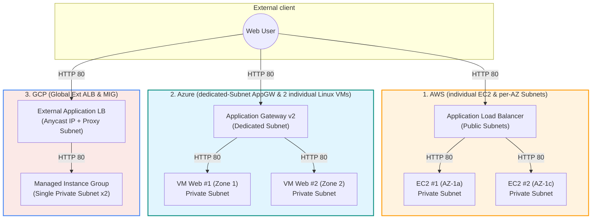

# Level 2 Multi-cloud Terraform Validation

[English](README.md) | [日本語](README.ja.md)

> **Translation note**: This English README was expanded on 2026-10-14 into a full translation of [README.ja.md](README.ja.md). It preserves the source record's dates, figures, evidence, and caveats. No new experiment was run, and the translation is not a fresh validation. For historical setup instructions and reproducibility limits, see Section 8 of the [final report](docs/final-report.en.md).

A consolidated repository comparing AI-driven Terraform lifecycles across AWS, Azure, and Google Cloud. It brings together the implementation, evidence, and final report for each cloud.

---

# Cloud Architecture Validation LEVEL 2 (Multi-cloud IaC Lifecycle, Consolidated)
### Consolidated Level 2 Multi-Cloud Terraform Validation (AWS / Azure / GCP)

<p align="center">
  <b>A consolidated repository for validating AI-driven Terraform lifecycles across the three major clouds: AWS, Azure, and GCP</b><br/>
  <i>Consolidated repository evaluating autonomous AI-driven Terraform lifecycles across AWS, Azure, and Google Cloud.</i>
</p>

<p align="center">
  <a href="docs/final-report.en.md"><b>📊 Cross-cloud Final Comparison Report (Final Report)</b></a> │
  <a href="aws/README.en.md"><b>🟧 AWS (orange)</b></a> │
  <a href="azure/README.en.md"><b>🟦 Azure (blue)</b></a> │
  <a href="gcp/README.en.md"><b>🟥 GCP (red)</b></a> │
  <a href="https://github.com/moruku36/cloud-validation-level3-astra-light"><b>🚀 Next stage: LEVEL 3 validation</b></a>
</p>

Color cues used in this repository: 🟧 orange = AWS, 🟦 blue = Azure, 🟥 red = GCP. The text labels are always given alongside the colors.

### Brief conclusion

*(Drawn from Sections 1 and 11 of the [full English final report](docs/final-report.en.md); see that report for the evidence and its limits.)*

- **Human role**: In this Level 2-equivalent validation, a human set the overall design, safety boundaries, review points, and approval points.
- **Codex role**: Within those boundaries, Codex completed most of the component selection, concrete Terraform implementation, CI/CD, short-lived authentication, Remote State, monitoring, failure testing, recovery, cleanup, and technical troubleshooting.
- **Scope of the success**: This is a success in three short-term, small-scale, disposable environments, with safety boundaries set by an experienced cloud engineer.
- **Execution success is not reproducibility**: Completion of the experiment and the ability to re-run the current code as is are separate assessments. The final report's code review found items to resolve before reproduction, such as an inconsistency between the AWS Terraform version and S3 locking (Section 8 of the final report).
- **Not a production-readiness claim**: Production TLS, WAF, notification delivery, SLOs, long-term operation, data migration, DR, and large-scale governance were not verified. The final evaluation is: "the defined Level 2 validation was completed on all three clouds; AI-led implementation and operations lifecycles were demonstrated, but production suitability and reproducibility of the current code require separate confirmation."

---

## English Summary

> **Objective & Scope**:
> This repository consolidates three sequential validations (AWS → Azure → GCP, with lessons carried forward) assessing how far AI (Codex) can implement, configure, test, and safely destroy a minimal, disposable cloud setup via Terraform across **AWS**, **Azure**, and **GCP**, under an overall design and safety boundaries set by a human. It is not a proof of production-grade operation.
>
> **Key Achievements (Level 2 Baseline)**:
> - **Unified Spec**: High-availability web infrastructure (L7 Load Balancer + 2 Private VMs without direct public SSH) across multi-AZ/subnets.
> - **End-to-End Lifecycle**: Automated bootstrapping (OIDC / Keyless Federation, Remote State), CI/CD pipelines (GitHub Actions), health monitoring, chaos injection (instance termination & failover), and clean destruction (0 lingering resources).
> - **Progression to Level 3**: Findings from this Level 2 baseline directly led to [cloud-validation-level3-astra-light](https://github.com/moruku36/cloud-validation-level3-astra-light), where autonomous agents tackle ambiguous enterprise requirements and multi-cloud architectural evaluations.

---

## 1. Project Overview

> [!IMPORTANT]
> **Status and usage policy of this repository**:
> All real resources in the validation environments have been cleanly destroyed (0 remaining). This repository serves both as a "validation record and comparative analysis report" and as "Terraform / CI definitions for reproduction."
> If you clone it and `apply` to a real environment, you must first provision OIDC / Remote State using each cloud's `bootstrap/`, and reconfigure the GitHub Repository Variables / Secrets.

This repository consolidates the deliverables from three environments (AWS, Azure, and GCP) that tested **"how far AI / Codex can be trusted with infrastructure implementation and operations lifecycles on public clouds."**

- **Positioning (LEVEL 2)**: For a minimal web platform (L7 LB + 2 Private VMs), the full flow from Bootstrap through CI/CD, monitoring, chaos testing, and complete destruction (Clean Destroy) was demonstrated on real infrastructure. (The definition of "LEVEL 2" is given below under "Certification-inspired levels and roles." It is not an industry-standard specification.)
- **AI environments used**: Validation was performed with autonomous AI agents such as OpenAI Codex and Google DeepMind Antigravity.
- **Next stage (LEVEL 3)**: Building on the findings of this validation, the work has progressed to [cloud-validation-level3-astra-light](https://github.com/moruku36/cloud-validation-level3-astra-light), in which an autonomous AI designs and evaluates from more advanced and ambiguous business requirements.

### Certification-inspired levels and roles (clarification added 2026-10-14)

This is a correction of the explanation of the existing experiment. The original creation dates, figures, comparison tables, evidence, source commits, and experiment records have not been changed.

Levels 1–3 in this validation are validation categories inspired by the progression seen in each cloud vendor's certification framework: Level 1 is foundational, Level 2 is intermediate with a focus on administration and implementation, and Level 3 is more advanced architect design and decision-making. Level 2 draws on the domains covered by certifications such as [Azure Administrator Associate](https://learn.microsoft.com/en-us/credentials/certifications/azure-administrator/), [AWS Solutions Architect – Associate](https://aws.amazon.com/certification/certified-solutions-architect-associate/), and [Google Cloud Associate Cloud Engineer](https://cloud.google.com/learn/certification/cloud-engineer). The vendors' certification frameworks and scopes differ, and these labels do not represent an official cross-vendor level, complete coverage of exam scope, or equivalence to any certification. References for the more advanced architect level: [AWS Solutions Architect – Professional](https://aws.amazon.com/certification/certified-solutions-architect-professional/), [Azure Solutions Architect Expert](https://learn.microsoft.com/en-us/credentials/certifications/azure-solutions-architect/), [Google Cloud Professional Cloud Architect](https://cloud.google.com/learn/certification/cloud-architect), and the [Google Cloud certification overview](https://cloud.google.com/learn/certification).

Roles: The repository owner did the overall design. They defined an IaaS configuration of LB + 2 VMs + network connectivity, and made monitoring, chaos testing, fault tolerance, and API operation requirements. Codex selected the concrete AWS/Azure/GCP components and carried out nearly all of the build and technical troubleshooting. The owner designed the process so that AWS results, tickets, and know-how were carried into Azure, and Azure's successes and failures were carried into GCP. The gradual increase in build speed is the owner's observation; it is not a controlled causal proof, model learning itself, or proof of job replacement (for caveats about confounding in the sequential experiments, see Section 9 of the [final report](docs/final-report.en.md)). The lesson is that the overall design, IAM permissions, monitoring policy, and credential boundaries must be understood, designed, and configured by a human. We distinguish between AI implementing concrete policies and monitoring definitions, and humans taking responsibility for the policies and boundaries.

---

## 2. Architecture Comparison of the Three Major Clouds

Each cloud adopts a minimal configuration that meets the same availability and security requirements: no direct SSH/connection from the internet to the VMs, and two Private VMs behind an L7 load balancer that respond with HTTP 200.



---

## 3. Validation Lifecycle Flow

On all clouds, the following seven phases were completed, with the human responsible for the overall design, approvals, and maintaining safety boundaries, and Codex responsible for concrete implementation and technical troubleshooting.

```mermaid
flowchart LR
    P1["Phase 1: Bootstrap<br/>(Storage & OIDC)"] --> P2["Phase 2: Core Infra<br/>(Network, LB, Compute)"]
    P2 --> P3["Phase 3: State Migration<br/>(Remote Lock)"]
    P3 --> P4["Phase 4: CI/CD Pipeline<br/>(GitHub OIDC)"]
    P4 --> P5["Phase 5: Monitoring<br/>(HealthCheck & Alarm)"]
    P5 --> P6["Phase 6: Chaos Test<br/>(Instance Kill & Recovery)"]
    P6 --> P7["Phase 7: Clean Destroy<br/>(Target Res: 0)"]

    style P1 fill:#E8EAF6,stroke:#3F51B5
    style P2 fill:#E8EAF6,stroke:#3F51B5
    style P3 fill:#E8EAF6,stroke:#3F51B5
    style P4 fill:#E8EAF6,stroke:#3F51B5
    style P5 fill:#FFF8E1,stroke:#FFA000
    style P6 fill:#FFEBEE,stroke:#E53935
    style P7 fill:#E8F5E9,stroke:#43A047
```



---

## 4. Cross-cloud Comparison Summary

| Item | 🟧 AWS | 🟦 Azure | 🟥 GCP |
|---|---|---|---|
| **Load balancer** | Application Load Balancer (ALB) | Application Gateway v2 (Standard_v2) | External Application Load Balancer (Global) |
| **Compute** | 2 standalone EC2 instances (placed per AZ) | 2 Linux VMs with Zones specified (Zone 1 / 2) | Managed Instance Group (Regional, 2 instances) |
| **Bastion / connectivity** | None (web server started via user data) | None (web server started via cloud-init) | None (web server started via startup-script) |
| **CI/CD authentication** | IAM OpenID Connect (OIDC) Role (single Role) | Microsoft Entra Workload Identity (PR / Apply separated) | Workload Identity Federation (PR / Apply SAs separated) |
| **Remote State** | S3 Bucket + S3 Native Lockfile | Blob Storage + Lease Lock | Google Cloud Storage (Object Lock) |
| **Monitoring** | CloudWatch Alarm (UnhealthyHostCount) + ALB Access Log | Application Gateway UnhealthyHostCount + Alert | Uptime Check + Metric Alert (Active Instances) |
| **Chaos test** | Verified degradation, alerting, and recovery when 1 instance was stopped | Verified detection, HTTP 200 maintained, and recovery when 1 VM was deallocated (stopped) | Verified degradation and self-healing when the MIG target size was reduced (2→1→2 instances) |
| **Clean Destroy** | 39 resources deleted, 0 remaining | All resource groups deleted, 0 remaining | All resources deleted, 0 remaining |

---

## 5. Directory Layout

```text
cloud-validation-level2-multicloud/
├── .github/workflows/                 # CI/CD for the monorepo (with paths filters)
│   ├── aws-pr.yml / aws-apply.yml
│   ├── azure-pr.yml / azure-apply.yml
│   └── gcp-pr.yml / gcp-apply.yml
├── scripts/                           # Integrated operations scripts
│   └── validate-all.ps1               # Format/validation script for all three clouds at once
├── LICENSE                            # MIT License
├── README.md                          # This file (English overall summary and diagrams; Japanese original: README.ja.md)
├── README.ja.md                       # Japanese original of the overall summary and diagrams
├── docs/                              # Technical documentation (Japanese originals *.md, English translations *.en.md)
│   ├── final-report.md                # Cross-cloud detailed comparison / final report (English: final-report.en.md)
│   ├── aws/                           # AWS-specific documents (01-09, handoff)
│   ├── azure/                         # Azure-specific documents (01-08)
│   └── gcp/                           # GCP-specific documents (01-08)
├── aws/                               # AWS Terraform code & Bootstrap
│   ├── README.md                      # AWS individual guide (including reproduction steps); English: README.en.md
│   ├── bootstrap/                     # HCL for OIDC / S3 State initialization
│   ├── scripts/                       # Script for S3 State migration
│   └── *.tf                           # VPC, ALB, EC2, CloudWatch definitions
├── azure/                             # Azure Terraform code & Bootstrap
│   ├── README.md                      # Azure individual guide (including reproduction steps); English: README.en.md
│   ├── bootstrap/                     # HCL for OIDC / Storage Account initialization
│   └── *.tf                           # VNet, AppGW, Linux VM, Monitor definitions
└── gcp/                               # GCP Terraform code & Bootstrap
    ├── README.md                      # GCP individual guide (including reproduction steps); English: README.en.md
    ├── bootstrap/                     # HCL for WIF / GCS State initialization
    └── *.tf                           # VPC, GCLB, MIG, Alert definitions
```

---

## 6. Prerequisites and Required Environment

These are the requirements for running and reproducing this repository's code locally and in CI/CD.

| Tool / CLI | Recommended version | Notes |
|---|---|---|
| **Terraform** | `>= 1.10.0, < 2.0.0` | 1.10+ is required to support the S3 native lockfile (`use_lockfile = true`) |
| **AWS CLI** | `v2.x` | For checks such as `aws sts get-caller-identity` |
| **Azure CLI** | `azure-cli 2.60+` | For checks such as `az account show` |
| **Google Cloud CLI** | `Google Cloud SDK 480.0+` | For `gcloud auth application-default login` |
| **PowerShell** | `7.x (pwsh)` / `5.1` | Execution environment for `validate-all.ps1` and `migrate-state.ps1` |

---

## 7. GitHub Actions Authentication and Variables/Secrets List

To run the CI/CD pipelines, the following must be registered in the GitHub repository's Variables and Secrets.

| Cloud | Name | Type | Where to set | Description |
|---|---|---|---|---|
| **Common** | `AWS_ENVIRONMENT_ACTIVE` | Variable | Repository | AWS cloud plan/apply runs only when `true` |
| **Common** | `AZURE_ENVIRONMENT_ACTIVE` | Variable | Repository | Azure cloud plan/apply runs only when `true` |
| **Common** | `GCP_ENVIRONMENT_ACTIVE` | Variable | Repository | GCP cloud plan/apply runs only when `true` |
| **AWS** | `AWS_REGION` | Variable | Repository | AWS deployment region (e.g. `ap-northeast-1`) |
| **AWS** | `AWS_TERRAFORM_ROLE_ARN` | Variable | Repository | IAM Role ARN assumed via GitHub OIDC |
| **AWS** | `TF_STATE_BUCKET` | Variable | Repository | Terraform S3 State bucket name |
| **AWS** | `TF_STATE_KEY` | Variable | Repository | S3 State object key (e.g. `terraform/aws-validation.tfstate`) |
| **Azure** | `AZURE_SUBSCRIPTION_ID` | Variable | Repository | Azure subscription ID |
| **Azure** | `AZURE_TENANT_ID` | Variable | Repository | Microsoft Entra tenant ID |
| **Azure** | `AZURE_PR_CLIENT_ID` | Variable | Repository | Client ID of the Managed Identity for PRs (Reader) |
| **Azure** | `AZURE_APPLY_CLIENT_ID` | Variable | Repository | Client ID of the Managed Identity for Apply (Contributor) |
| **Azure** | `TF_STATE_RESOURCE_GROUP` | Variable | Repository | Resource Group name of the State Storage Account |
| **Azure** | `TF_STATE_STORAGE_ACCOUNT` | Variable | Repository | State Storage Account name |
| **Azure** | `TF_STATE_CONTAINER` | Variable | Repository | State Blob Container name |
| **Azure** | `TF_STATE_KEY` | Variable | Repository | State Blob key (e.g. `terraform/azure-validation.tfstate`) |
| **GCP** | `GCP_PROJECT_ID` | Secret | Repository | Target Google Cloud project ID |
| **GCP** | `GCP_WIF_PROVIDER` | Secret | Repository | WIF Provider resource name (`projects/.../locations/global/workloadIdentityPools/.../providers/...`) |
| **GCP** | `GCP_PR_SA_EMAIL` | Secret | Repository | Service Account email for PRs (Viewer / State Reader) |
| **GCP** | `GCP_APPLY_SA_EMAIL` | Secret | Repository | Service Account email for Apply (Editor / State Admin) |
| **GCP** | `GCP_STATE_BUCKET` | Secret | Repository | GCS bucket name for State |
| **GCP** | `GCP_STATE_PREFIX` | Secret | Repository | GCS prefix for State (e.g. `terraform/root`) |

> [!NOTE]
> **Variable-name scope and cautions in the monorepo**:
> - Each Azure identifier is referenced in the workflows as `vars.*` (Repository Variables).
> - Both AWS and Azure use a variable with the same name, `TF_STATE_KEY`. If you operate both in a single GitHub repository at the same time, the values collide, so either separate the key names on the workflow side (e.g. `AWS_TF_STATE_KEY` / `AZURE_TF_STATE_KEY`) or switch them per environment.

---

## 8. Local Validation and Batch Check

From the repository root, the following command runs syntax checks and validation for all clouds (and bootstrap) at once:

```powershell
# Run terraform fmt & validate for all environments at once
./scripts/validate-all.ps1
```

---

## 9. Links to Detailed Documentation for Each Cloud

These are the English translations (`.en.md`) of the Japanese originals, added 2026-10-14. They preserve the original records' dates, data, and caveats. No new experiment was run.

### 🟧 AWS (orange)
- Provider guide: [aws/README.en.md](aws/README.en.md)
- [Bootstrap guide (English)](aws/bootstrap/README.md)
- [AWS Scenario](docs/aws/01-scenario.en.md) │ [Architecture](docs/aws/02-architecture.en.md) │ [Implementation Steps](docs/aws/03-implementation.en.md)
- [Troubleshooting](docs/aws/04-troubleshooting.en.md) │ [Results](docs/aws/05-results.en.md) │ [Lessons Learned](docs/aws/06-lessons-learned.en.md)
- [CI/CD & OIDC](docs/aws/07-cicd-oidc-remote-state.en.md) │ [Monitoring Design](docs/aws/08-monitoring.en.md) │ [Handoff](docs/aws/handoff-antigravity.en.md) │ [Cleanup](docs/aws/09-final-results-and-cleanup.en.md)

### 🟦 Azure (blue)
- Provider guide: [azure/README.en.md](azure/README.en.md)
- [Bootstrap guide (English)](azure/bootstrap/README.en.md)
- [Azure Scenario](docs/azure/01-scenario.en.md) │ [Architecture](docs/azure/02-architecture.en.md) │ [Implementation Steps](docs/azure/03-implementation.en.md)
- [Troubleshooting](docs/azure/04-troubleshooting.en.md) │ [Results](docs/azure/05-results.en.md) │ [Lessons Learned](docs/azure/06-lessons-learned.en.md)
- [CI/CD & OIDC](docs/azure/07-cicd-oidc-remote-state.en.md) │ [Monitoring Design](docs/azure/08-monitoring.en.md)

### 🟥 GCP (red)
- Provider guide: [gcp/README.en.md](gcp/README.en.md)
- [GCP Scenario](docs/gcp/01-scenario.en.md) │ [Architecture](docs/gcp/02-architecture.en.md) │ [Implementation Steps](docs/gcp/03-implementation.en.md)
- [Troubleshooting](docs/gcp/04-troubleshooting.en.md) │ [Results](docs/gcp/05-results.en.md) │ [Lessons Learned](docs/gcp/06-lessons-learned.en.md)
- [CI/CD & WIF](docs/gcp/07-cicd-oidc-remote-state.en.md) │ [Monitoring Design](docs/gcp/08-monitoring.en.md)

### Cross-cloud report
- [Final Report (English)](docs/final-report.en.md) (Japanese original: [docs/final-report.md](docs/final-report.md))

---

## 10. Related Repositories

- **Next stage, LEVEL 3**: [cloud-validation-level3-astra-light](https://github.com/moruku36/cloud-validation-level3-astra-light)
  - From ambiguous business requirements, an autonomous AI (GPT-6 Astra Light) performed architecture selection, cost estimation, and paper-based evaluation.
