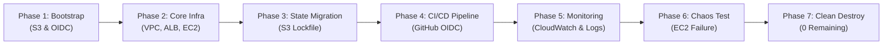
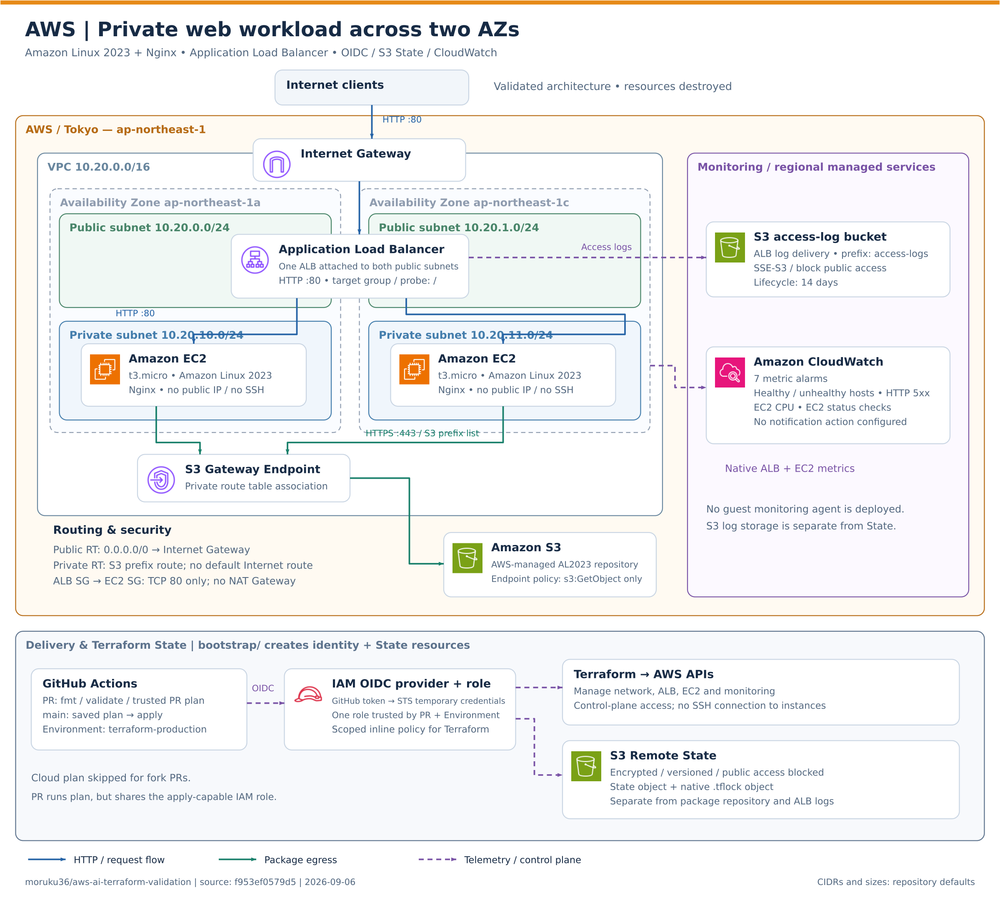
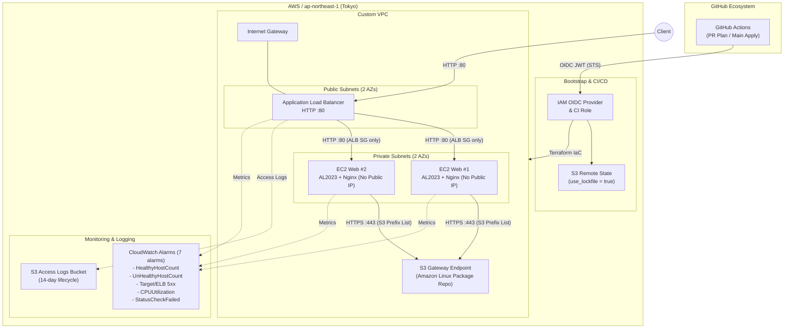

[English](README.en.md) | [日本語](README.md)

> **Note:** This is an English translation added on 2026-10-14. It preserves the dates, data, and caveats of the original Japanese record. No new experiment was run for this translation.

# AWS + Terraform Validation Environment

**[Cross-cloud AWS / Azure / GCP Final Comparison Report](../docs/final-report.en.md)**: execution results, AI failures and recovery, human responsibilities, and reproducibility review.

The historical records below retain their original scope and status. For the updated explanation of the certification-inspired Level 1–3 categories and the human/Codex division of responsibility, see the [consolidated project overview](../README.md).

## Validation Purpose

This is a minimal, disposable Terraform environment used to validate how much AWS infrastructure implementation can be delegated to AI/Codex. The full sequence of validation has been completed: build, failure fixes, CI/CD, OIDC, Remote State, monitoring, failure testing, and final deletion.

This directory contains the AWS-specific Terraform validation setup and execution records for Multi-cloud Validation Level 2. Its scope covers the following:

- VPC, subnet, Internet Gateway, and route table configuration
- Security Groups with least-privilege inbound and outbound rules
- Target compute deployment and CloudWatch monitoring/alarm integration
- End-to-end automated lifecycle verification: `plan` -> `apply` -> `verify` -> `destroy`

## Current Progress

- Built a VPC, two Public Subnets and two Private Subnets, an ALB, and two Private EC2 instances in the AWS Tokyo region, and confirmed HTTP 200 through the ALB
- Demonstrated CI/CD with GitHub Actions, OIDC temporary credentials, S3 Remote State, and the S3 native lockfile
- Added CloudWatch alarms and ALB access logs, and confirmed alarm firing and recovery in a backend failure test that kept the service running
- Ran the final destroy after confirming that the preceding plan showed 39 deletions and no replacements
- Deleted the Root, bootstrap, Remote State, OIDC Provider, IAM Role, and temporary IAM policy, and confirmed that no target resources remained

> This repository does not contain credentials, Terraform state, or real-environment resource IDs or IP addresses. The AWS validation environment has now been deleted.

## Validation Lifecycle Flow



## Architecture Diagram





For details on the components and design decisions, see [Architecture](../docs/aws/02-architecture.en.md).

## Final Results Summary

### Quantitative Metrics

| Metric | Actual value / status | Visual indicator |
|---|---|---|
| **Overall score** | **93 / 100** | `█████████░ 93%` |
| **HTTP 200 availability** | No outage during the failure test | `██████████ 100%` |
| **Complete deletion of Root resources** | 39 / 39 deleted | `██████████ 100%` |
| **Complete deletion of Bootstrap** | 9 / 9 deleted | `██████████ 100%` |
| **Remaining resources in the environment** | 0 | `░░░░░░░░░░ 0` |

### Status by Validation Item

| Item | Result |
| --- | --- |
| Terraform build | Succeeded. The configuration, including 2 Private EC2 instances, an ALB, and an S3 Endpoint, is managed as reproducible code |
| CI/CD | Succeeded with a read-only plan on PRs and an apply on main protected by a GitHub Environment |
| AWS authentication | Used OIDC temporary credentials without storing long-lived Access Keys in GitHub |
| State | Used S3 Remote State with `use_lockfile = true`, and confirmed `No changes` after migration |
| Monitoring | Implemented 7 CloudWatch alarms and ALB access logs |
| Failure test | Confirmed alarm firing and recovery for a backend failure while maintaining HTTP 200 for normal service |
| Estimated cost | About 0.25 USD in total for the related services during the validation period (a rough estimate, not actuals by tag) |
| Cleanup | Deleted 39 Root resources, 9 bootstrap resources, all State versions, and the temporary IAM policy. No target resources remain |

Human intervention was counted as 8 categories of meaningful operation units. The AI autonomously performed design, implementation, diagnosis, CI/CD operations, failure testing, recovery, deletion, and remaining-resource checks. The final score is **93 / 100**. The aggregation criteria, all failures, and the reasons for point deductions are recorded in [Final Results and Cleanup](../docs/aws/09-final-results-and-cleanup.en.md).

## Reproduction Steps (5 Common Steps)

Prerequisites: Terraform `>= 1.10.0, < 2.0.0`, a local environment authenticated with the AWS CLI, and the minimum permissions needed to create the target resources. Because the environment, including bootstrap, has now been deleted, apply the following steps when re-validating.

```powershell
# 1. Check prerequisites and prepare environment variables
aws sts get-caller-identity

# 2. Build Bootstrap (S3 State Bucket & GitHub OIDC Role)
Copy-Item bootstrap/terraform.tfvars.example bootstrap/terraform.tfvars
# Set the identifiers in bootstrap/terraform.tfvars
terraform -chdir=bootstrap init
terraform -chdir=bootstrap plan -out=tfplan
terraform -chdir=bootstrap apply tfplan

# 3. Backend configuration (enable Remote State)
Copy-Item backend.tf.example backend.tf
Copy-Item terraform.tfvars.example terraform.tfvars
terraform init -backend-config="bucket=<YOUR_TF_STATE_BUCKET>" -backend-config="key=terraform/aws-validation.tfstate" -backend-config="region=ap-northeast-1" -backend-config="encrypt=true"

# 4. Apply Root (Core Infra & Monitoring)
terraform fmt -check
terraform validate
terraform plan -out=tfplan
terraform apply tfplan
terraform output -raw alb_url

# 5. Clean Destroy (at the end of validation)
terraform destroy
terraform -chdir=bootstrap destroy
```

## Documentation

- [Validation Scenario](../docs/aws/01-scenario.en.md)
- [Architecture](../docs/aws/02-architecture.en.md)
- [Implementation](../docs/aws/03-implementation.en.md)
- [Troubleshooting](../docs/aws/04-troubleshooting.en.md)
- [Validation Results](../docs/aws/05-results.en.md)
- [Lessons Learned and Next Steps](../docs/aws/06-lessons-learned.en.md)
- [CI/CD, OIDC, and Remote State](../docs/aws/07-cicd-oidc-remote-state.en.md)
- [Monitoring Design and Implementation Status](../docs/aws/08-monitoring.en.md)
- [Handoff for Antigravity](../docs/aws/handoff-antigravity.en.md)
- [Final Results, Score, and Cleanup](../docs/aws/09-final-results-and-cleanup.en.md)

## Notes for Re-running and Known Considerations (Gotchas)

> [!WARNING]
> **1. Mismatch between the Terraform version and S3 Native State Locking**:
> `use_lockfile = true` in `backend.tf.example` is a feature supported from **Terraform v1.10.0** onward. It causes a syntax error on Terraform v1.9.x and earlier, so Terraform v1.10+ is required both locally and in CI (if you operate an older version, you must switch to `dynamodb_table` locking).
>
> **2. Separation of IAM Role permissions**:
> During validation, the same IAM role was used for PR (plan) and Apply. In a production environment, it is recommended to separate a ReadOnly / Plan-only permission set for PRs.
