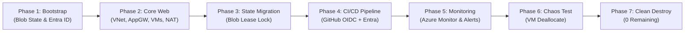
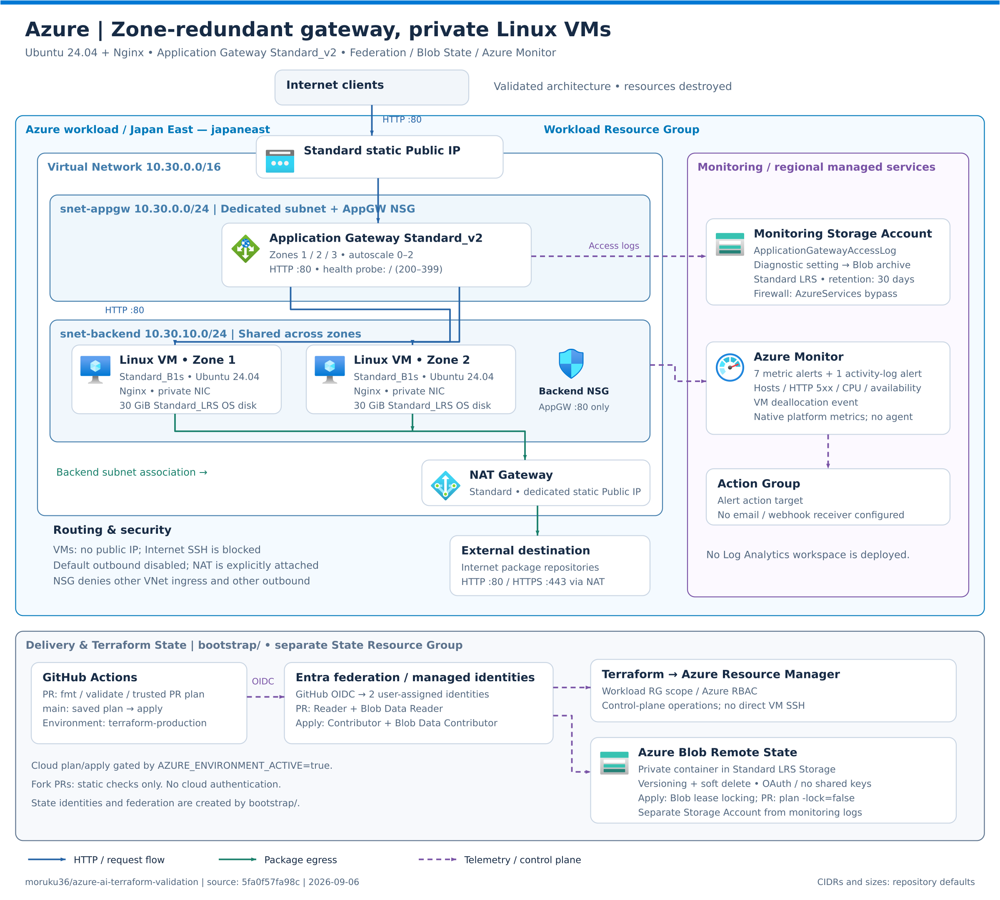
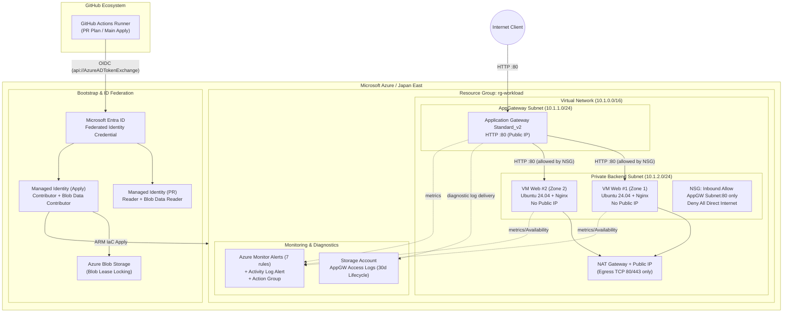

[English](README.en.md) | [日本語](README.md)

> This is an English translation added on 2026-10-14. The dates, data, results, and caveats of the original record are preserved. No new experiment was run for this translation. The results describe this single experiment only and are not a guarantee of reproducibility or production readiness.

# Azure AI Terraform Validation

**[AWS / Azure / GCP Cross-Cloud Final Comparison Report](../docs/final-report.en.md)** — Execution results, AI failures and recovery, human responsibilities, and reproducibility review.

The historical records below retain their original scope and status. For the updated explanation of the certification-inspired Level 1–3 categories and the human/Codex division of responsibility, see the [consolidated project overview](../README.md).

## Validation Objective

From common requirements written in natural language, verify whether AI/Codex can design an Azure-native configuration and autonomously implement it through Terraform, GitHub Actions, Workload Identity Federation, Remote State, Monitoring, failure testing, and cleanup.

Rather than simply substituting service names from the AWS edition, this record documents Azure-specific design decisions on networking, Microsoft Entra ID, Azure RBAC, Blob lease locking, and Azure Monitor.

## Validation Lifecycle Flow



## Architecture Overview

- Region: Japan East
- Internet exposure: Application Gateway Standard_v2, HTTP 80 only
- Backend: 2 private Linux VMs placed in separate Availability Zones
- VM Public IP / Internet SSH: none
- Outbound: NAT Gateway associated with the private subnet
- Security: NSG allows only HTTP 80 from the Application Gateway Subnet to the VMs
- State: Local State for the initial build, migrated to Azure Blob in a later phase
- Monitoring / CI/CD: added in stages after basic connectivity was confirmed





For details on the components and design decisions, see [Azure Architecture](../docs/azure/02-architecture.en.md).

## Final Result Summary

### Quantitative Metrics

| Metric | Actual value / status | Visual indicator |
|---|---|---|
| **Overall evaluation** | **Success (Level 2 autonomous achievement)** | `██████████ 100%` |
| **HTTP 200 availability** | No downtime during failure testing | `██████████ 100%` |
| **Complete deletion of root resources** | 41 / 41 deleted | `██████████ 100%` |
| **Complete deletion of bootstrap** | 12 / 12 deleted | `██████████ 100%` |
| **Remaining resources in the environment** | 0 | `░░░░░░░░░░ 0 remaining` |

### Status by Validation Item

| Item | Result |
|---|---|
| Terraform web foundation | 2 private VMs, HTTP 200 via Application Gateway |
| CI/CD | PR fmt/init/validate/plan and main saved-plan apply succeeded |
| Identity | GitHub OIDC + Entra Federated Identity. No Client Secret used |
| Remote State | Migrated to Azure Blob; encryption, Versioning, and Soft Delete enabled |
| State locking | Demonstrated conflict rejection by Blob lease and recovery after release |
| Monitoring | Azure Monitor Alerts, Action Group, and diagnostic logs managed by Terraform |
| Failure test | Detected the stop of 1 VM, HTTP 200 continued, Resolved confirmed after recovery |
| Final consistency | `No changes` both locally and in GitHub Actions |
| Cleanup | Deleted 41 root and 12 bootstrap resources; confirmed 0 remaining target resources |

The AI was able to carry out design, Terraform, CI/CD, OIDC, State migration, monitoring, failure testing, and root-cause analysis almost end to end. Humans were responsible for specifying the Subscription, approving the design and permissions, GitHub identity verification, and approving destructive operations.

The Azure edition is evaluated as a success. For standard web infrastructure, CI/CD, Federation, State, Monitoring, failure testing, and cleanup at a cloud engineer Level 2 equivalent, most of the work could be delegated to AI given appropriate safety boundaries and human approval. Responsibility for high privileges, billing and exposure methods, Account identity verification, and the final destroy remains with humans.

## Main Differences from the AWS Edition

- Application Gateway requires a dedicated Subnet, and NAT Gateway was adopted for explicit outbound from the private VMs.
- Entra Federated Credential and Azure RBAC separate the roles of Identity, Federation, and Scope more than AWS IAM Trust Policy and Permission Policy do.
- The Azure Blob Backend performs locking with a lease on the State Blob itself, which differs from the S3 native lockfile used in the AWS edition.
- For monitoring logs, a dedicated Storage archive was adopted to avoid registering the Log Analytics Provider and its ingestion costs.
- The Resource Group can be used as a clear creation and cleanup boundary.

## Reproduction Steps (Common 5 Steps)

Prerequisites: Terraform `>= 1.10.0, < 2.0.0`, logged in to Azure CLI, and sufficient permissions on the target subscription. The resource groups have since been deleted, so apply the following steps when re-validating.

```powershell
# 1. Pre-create the workload resource group (the RBAC binding target for Root and Bootstrap)
# * Root Terraform (main.tf) also manages creation of this RG. When pre-creating it, either import it or create it
#    before applying Bootstrap, and align the name with the Root definition (a placeholder such as rg-aitev-dev).
az group create --name <WORKLOAD_RESOURCE_GROUP_NAME> --location japaneast

# 2. Build Bootstrap (State Storage & Workload Identity)
Copy-Item bootstrap/terraform.tfvars.example bootstrap/terraform.tfvars
# Set identifiers in bootstrap/terraform.tfvars (storage_account_suffix, workload_resource_group_name, etc.)
terraform -chdir=bootstrap init
terraform -chdir=bootstrap plan -out=tfplan
terraform -chdir=bootstrap apply tfplan

# 3. Backend configuration (enable Remote State)
Copy-Item backend.tf.example backend.tf
Copy-Item terraform.tfvars.example terraform.tfvars
# Set the SSH public key etc. in terraform.tfvars
terraform init -backend-config="resource_group_name=<STATE_RESOURCE_GROUP_NAME>" -backend-config="storage_account_name=<YOUR_STORAGE_ACCOUNT>" -backend-config="container_name=tfstate" -backend-config="key=terraform/azure-validation.tfstate"

# 4. Apply Root (VNet, AppGW, Linux VM, Monitoring)
terraform fmt -check
terraform validate
terraform plan -out=tfplan
terraform apply tfplan
terraform output -raw application_url

# 5. Clean Destroy (at the end of validation)
terraform destroy
terraform -chdir=bootstrap destroy
az group delete --name <WORKLOAD_RESOURCE_GROUP_NAME> --yes --no-wait
```

## Documents

- [Validation Scenario](../docs/azure/01-scenario.en.md)
- [Azure Architecture](../docs/azure/02-architecture.en.md)
- [Terraform Implementation](../docs/azure/03-implementation.en.md)
- [Troubleshooting](../docs/azure/04-troubleshooting.en.md)
- [Validation Results](../docs/azure/05-results.en.md)
- [Lessons Learned and AWS Comparison](../docs/azure/06-lessons-learned.en.md)
- [CI/CD, OIDC, and Remote State](../docs/azure/07-cicd-oidc-remote-state.en.md)
- [Monitoring](../docs/azure/08-monitoring.en.md)

## Notes for Re-running and Known Considerations (Gotchas)

> [!WARNING]
> **1. Resource dependency locks during cleanup**:
> When deleting the Application Gateway and the individual Backend VMs (NIC / backend pool association), running an individual `terraform destroy` instead of deleting the resource group may cause temporary timeouts or errors while waiting for the NIC bindings to be released. Deleting everything at once by resource group is the most reliable.
>
> **2. Subject consistency of the Entra Workload Identity**:
> Confirm that the Subject claim of the OIDC token for PRs (`repo:moruku36/cloud-validation-level2-multicloud:pull_request`) matches the Federated Credential on the Entra side exactly.
