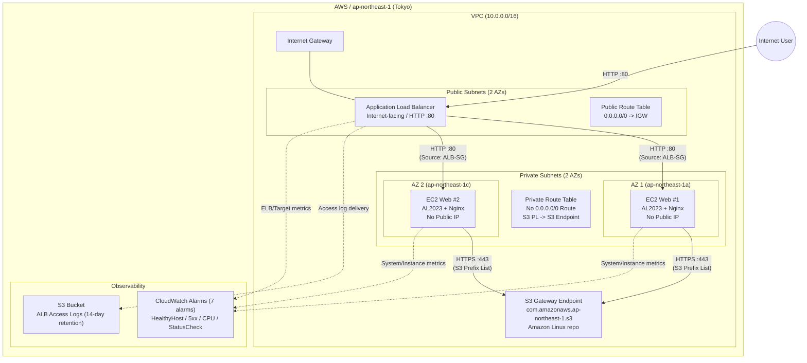

[English](02-architecture.en.md) | [日本語](02-architecture.md)

> **Note:** This is an English translation added on 2026-10-14. It preserves the dates, data, and caveats of the original Japanese record. No new experiment was run for this translation.

# Architecture

## Architecture Diagram

## Traffic Rules and Security Boundaries

### Security Group Rule Matrix

| Resource | Direction | Protocol / Port | Source / Destination | Purpose / Notes |
| --- | --- | --- | --- | --- |
| **ALB SG** | Ingress | TCP / 80 | `0.0.0.0/0` | HTTP access from the internet |
| **ALB SG** | Egress | TCP / 80 | EC2 SG | Traffic forwarding and Health Checks to the backend EC2 instances |
| **EC2 SG** | Ingress | TCP / 80 | ALB SG | Only forwarding from the ALB is allowed (no direct access) |
| **EC2 SG** | Egress | TCP / 443 | `pl-xxxx` (AWS managed S3 prefix list) | AL2023 package repository (dnf / Nginx installation) |
| **EC2 SG** | Egress | TCP / 80 | Not allowed | External web traffic prohibited |
| **EC2 SG** | Ingress | TCP / 22 | Not allowed | SSH access prohibited (not open to either the internet or local networks) |

### Routing Design

| Route Table | Destination CIDR / target | Via | Notes |
|---|---|---|---|
| **Public Route Table** | `0.0.0.0/0` | Internet Gateway (IGW) | For exposing the ALB to the internet |
| **Private Route Table** | S3 Prefix List | S3 Gateway Endpoint | Communication via a VPC endpoint (free and private) |
| **Private Route Table** | `0.0.0.0/0` | **None (default route not created)** | No direct internet egress; no NAT Gateway deployed |

## AWS-Specific Design Decisions

1. **Eliminating the NAT Gateway and adopting the S3 Gateway Endpoint**:
   - OS packages for the Private EC2 instances (Amazon Linux 2023) are delivered from AWS-managed S3 repositories.
   - By not deploying a NAT Gateway and instead using egress-limited routing through the free S3 Gateway Endpoint and the S3 Managed Prefix List, the NAT Gateway running cost (about 32 USD/month) was avoided while still ensuring sufficient security.
2. **High availability through 2-AZ distribution**:
   - The ALB and EC2 instances are placed across two different AZs in the Tokyo region (`ap-northeast-1a`, `ap-northeast-1c`) to provide tolerance to the failure of one AZ.
3. **Fully SSH-less operation**:
   - No SSH port is opened and no key pair is configured on the EC2 instances; Nginx is started solely through autonomous provisioning with user data (cloud-init). This minimizes the attack surface.
