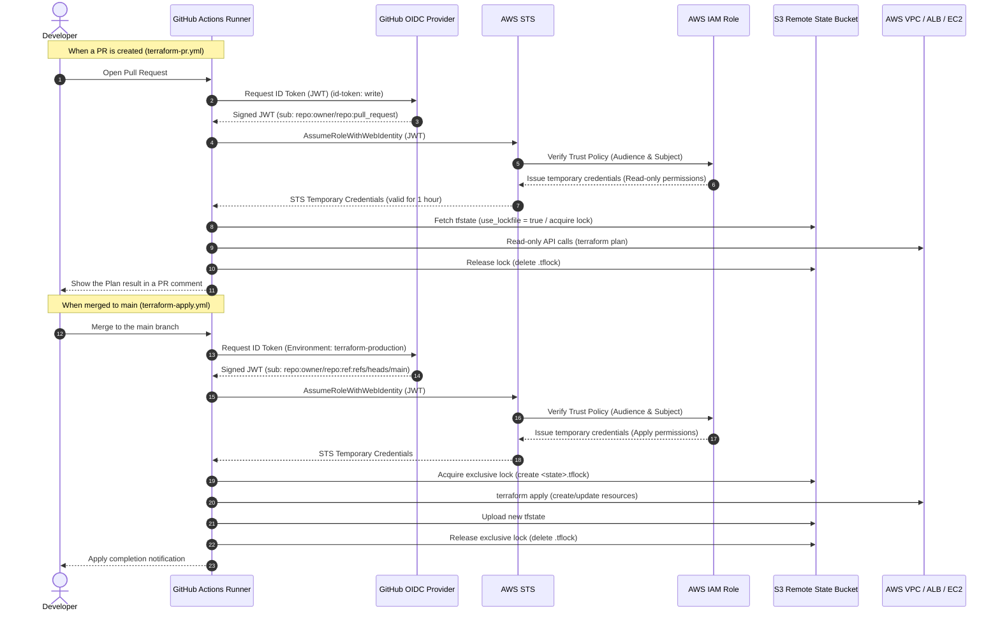

[English](07-cicd-oidc-remote-state.en.md) | [日本語](07-cicd-oidc-remote-state.md)

> **Note:** This is an English translation added on 2026-10-14. It preserves the dates, data, and caveats of the original Japanese record. No new experiment was run for this translation. The execution log below is a historical record in chronological order; later entries supersede earlier states, and past plans or pending steps are not current instructions.

# CI/CD, OIDC, and Remote State

## Adopted Design

| Item | Design |
| --- | --- |
| CI | Always run format, init, and validate on Pull Requests |
| PR plan | Only for PRs from the same repository, authenticate with OIDC and run a plan against the Remote State |
| apply | Run only on a push to `main`. Uses the GitHub Environment `terraform-production` |
| AWS authentication | Obtain short-lived STS credentials through GitHub Actions OIDC |
| State | S3 (versioning, SSE-S3, Public Access Block) and the S3 native lockfile |
| State protection | The State Bucket enforces HTTPS, and the CI Role is allowed only the State Object and the lockfile |

The workflows are in `.github/workflows/terraform-pr.yml` and `.github/workflows/terraform-apply.yml`. To avoid a circular dependency, the creation of the Remote State and the creation of the OIDC Role are managed independently in `bootstrap/`.

## Reason for Changing from the DynamoDB Approach

In HashiCorp's current [S3 Backend official documentation](https://developer.hashicorp.com/terraform/language/backend/s3), DynamoDB-based locking is deprecated and is planned for removal in a future minor version. Therefore, we set `use_lockfile = true` on `backend "s3"` and adopted the approach of using the `<state key>.tflock` created in S3 for mutual exclusion.

This approach removes the need for a DynamoDB table, its charges, and additional IAM permissions. In line with the minimum permissions specified in the official documentation, only `GetObject` and `PutObject` are allowed on the State Object, and only `GetObject`, `PutObject`, and `DeleteObject` on the lockfile. `DeleteObject` is not granted on the State Object itself.

## Minimizing Temporary Permissions for bootstrap

The human Identity that runs bootstrap needs creation permissions for a short period, separately from the execution Role for GitHub Actions. This temporary policy restricts the State Bucket and the Terraform Role by name, and does not grant `iam:PassRole` or the destroy-related `DeleteRole`, `DeleteRolePolicy`, and `DeleteOpenIDConnectProvider`.

According to the AWS IAM Service Authorization Reference, `iam:CreateOpenIDConnectProvider` can specify the `oidc-provider` resource type as the Resource. Therefore, the temporary policy also does not use `Resource: "*"` and is restricted to the OIDC Provider ARN that represents only GitHub Actions' `token.actions.githubusercontent.com`.

This temporary policy is deleted after bootstrap completes. When bootstrap resources are deleted in a future cleanup, only the deletion APIs are to be issued as a separate temporary policy and must not be mixed into the permissions for normal operation.

## OIDC Authentication and CI/CD Pipeline Flow



Long-lived Access Keys and Secret Access Keys are not stored in GitHub Secrets. The GitHub Actions `configure-aws-credentials` action exchanges the OIDC token with STS and receives credentials that are valid only during the job.

## IAM Design

`bootstrap/` sets the following restrictions in the Trust Policy.

- The Audience is `sts.amazonaws.com` only.
- The Subject is only the `main` branch and PR events of the specified `owner/repository`.
- A push to anything other than `main` cannot assume the apply Role.

The permissions Policy is limited to the specified State Key and its corresponding lockfile in the State Bucket, and to the EC2 and ELB operations required for this VPC/EC2/ELB configuration. It does not include permissions to create IAM Users, Access Keys, NAT Gateways, or Elastic IPs.

For PRs from forks, the AWS authentication and plan job are not run. Only format and validate are run, so AWS permissions are not given to untrusted code.

## State Management

- S3 Bucket: Enable Public Access Block, Bucket Owner Enforced, versioning, and SSE-S3.
- Bucket Policy: Explicitly deny access that does not use TLS.
- S3 native lockfile: With `use_lockfile = true`, concurrent updates are excluded using `<state key>.tflock`, which is in the same prefix as the State Key.
- No deletion permission is granted for the State Object, and only deletion of the lockfile is allowed. Because plan artifacts are not saved, values derived from the State are not carelessly exposed.

## Initial Setup (Requires Manual Configuration by a Person)

To fix the OIDC Trust Policy safely, the following two values must be exact and must not be set by guessing.

1. The GitHub repository name (`owner/repository`)
2. A globally unique State Bucket name

Setup steps:

1. Copy `bootstrap/terraform.tfvars.example` to `bootstrap/terraform.tfvars` and set the two values above.
2. If the AWS account already has a GitHub OIDC Provider, set its ARN in `github_oidc_provider_arn`. If not, bootstrap creates one.
3. In the `bootstrap` directory, check `terraform init` and `terraform plan`, then run `terraform apply`.
4. Set the bootstrap outputs as GitHub Actions Variables.

| GitHub Actions Variable | Value |
| --- | --- |
| `AWS_REGION` | `ap-northeast-1` |
| `AWS_TERRAFORM_ROLE_ARN` | `github_actions_role_arn` output |
| `TF_STATE_BUCKET` | `state_bucket_name` output |
| `TF_STATE_KEY` | `state_key` output |

5. Create the `terraform-production` Environment in GitHub, and configure branch protection for `main` and any required approval rules.
6. Keep a backup of the local State and run the following.

```powershell
.\scripts\migrate-state.ps1 `
  -StateBucket "<State Bucket name>"
```

This script runs a plan after `terraform init -migrate-state`. If the result is anything other than `No changes`, it exits without applying, so you can review the differences before deciding on the next operation.

## Execution Verification Results

- The Remote Backend has not yet been enabled for the existing Terraform environment. Therefore, there are no changes to the State and resources that are currently running.
- For the Root configuration and the bootstrap configuration, format/validate is run in local verification with the backend disabled.
- The actual Remote State migration, OIDC Role creation, and GitHub Actions runs will be performed after the GitHub repository name and State Bucket name above are finalized.

## Execution Log and Migration Results

### What the AI Performed Autonomously

1. Set the State Bucket name, GitHub repository name, and State Key in bootstrap's local variables file. This file is excluded from Git management, and the concrete values are not recorded in the public documentation.
2. Ran bootstrap's `terraform plan -out=tfplan` and confirmed that the S3 Bucket and its protection settings, the GitHub OIDC Provider, and the IAM Role for Terraform with its inline Policy were to be added. DynamoDB was not included in the plan.
3. After reviewing the plan, attempted `terraform apply tfplan`.
4. After the failure, checked the bootstrap State and confirmed that the number of managed resources was 0. There were no changes to the existing application State or the AWS environment.

### Commands Executed (Generalized)

```powershell
# bootstrap
terraform -chdir=bootstrap plan -out=tfplan
terraform -chdir=bootstrap apply tfplan

# State migration to be run after permissions are granted
.\scripts\migrate-state.ps1 -StateBucket "<State Bucket name>"

# Post-migration check
terraform plan -lock-timeout=5m
```

### Errors and Causes

The bootstrap apply stopped because the execution Identity lacked the following creation permissions.

- S3 permissions for creating the State Bucket
- IAM permissions for creating the GitHub Actions OIDC Provider

This error was not a Terraform configuration error; it was because the existing least-privilege Identity had not been granted bootstrap creation permissions. At the time of failure there were no created resources in the State, and no rollback operation was needed.

### What Requires Human Intervention

The AWS account administrator needs to do one of the following.

1. Apply `bootstrap` with an approved Identity that has administrator permissions.
2. Temporarily grant the current execution Identity S3 creation and protection-setting permissions restricted to the specified State Bucket, permission to create the GitHub OIDC Provider, and permissions to create the specified Terraform Role and set its inline Policy.

Examples of the required permissions are `s3:CreateBucket`, `s3:PutBucketPublicAccessBlock`, `s3:PutBucketOwnershipControls`, `s3:PutBucketVersioning`, `s3:PutEncryptionConfiguration`, `s3:PutBucketPolicy`, `iam:CreateOpenIDConnectProvider`, `iam:CreateRole`, `iam:PutRolePolicy`, and the corresponding read and tagging permissions. There is no need to give broad, standing Administrator permissions to the GitHub Actions Role.

### Checks to Perform After Apply

After permissions are granted, the AI performs the following in order.

1. Re-run bootstrap plan/apply.
2. Check the S3 Bucket's Versioning, Public Access Block, encryption, TLS enforcement, and the GitHub OIDC Role.
3. Organize the GitHub Variables (`AWS_REGION`, `AWS_TERRAFORM_ROLE_ARN`, `TF_STATE_BUCKET`, `TF_STATE_KEY`).
4. Back up the local State under a name that does not overwrite it.
5. Migrate the State to the S3 Backend that includes `use_lockfile = true`.
6. Run `terraform plan` immediately after migration and confirm `No changes`. If there is a diff, stop without applying.

### Resumption Attempt (After Permissions Were Granted)

We checked the current execution Identity with `aws sts get-caller-identity` (the account ID and ARN are not recorded). We then applied the saved bootstrap plan, but it stopped because the following two Actions were not allowed for the execution Identity.

- `s3:CreateBucket` on the specified State Bucket
- `iam:CreateOpenIDConnectProvider` on the GitHub Actions OIDC Provider resource

For this reason, the bootstrap resources, the local State backup, the Remote State migration, and a re-plan of the Root configuration were not carried out. No automatic expansion of permissions and no changes to the existing AWS environment were made. The plan before apply was the same as the previous one, with 9 resources to add and 0 changes or deletions.

#### What Requires Human Intervention (Updated)

It is necessary to confirm that the following permissions, dedicated to bootstrap, are actually attached to the current temporary inline policy.

- `s3:CreateBucket`: restricted to the specified State Bucket ARN
- `iam:CreateOpenIDConnectProvider`: restricted to the OIDC Provider ARN for `token.actions.githubusercontent.com`

According to the IAM Service Authorization Reference, the latter can be restricted to the OIDC Provider resource. Resume the bootstrap apply only after these have taken effect. For the Remote State migration, do not reuse the temporary permissions for bootstrap; use separately approved minimum S3 permissions for State migration.

### Read-only Verification of the Grant State

Before re-running apply, we confirmed with STS that the current execution Identity was the intended IAM User. We then ran `iam list-user-policies`, but that User was not allowed `iam:ListUserPolicies`, so the existence and contents of the inline policy could not be confirmed from the CLI.

This is not a result that directly shows the temporary bootstrap policy has not been granted; it shows that there is no permission to read the IAM settings. We stopped without retrying apply on speculation. A person with administrative permissions needs to confirm, using the IAM Console or a separate audit Identity, that the temporary inline policy has been granted to the target User and that its contents include `s3:CreateBucket` and `iam:CreateOpenIDConnectProvider` restricted to the OIDC Provider ARN.

### bootstrap Resumption Result

After the administrator confirmed the grant, we re-ran the bootstrap plan. The plan was identical to the previous one: only 9 resources to add (the S3 State Bucket and its protection settings, the GitHub Actions OIDC Provider, and the GitHub Actions Terraform Role with its inline Policy), with 0 changes or deletions of existing resources.

We applied the saved plan, but it stopped again with AccessDenied for `s3:CreateBucket` and `iam:CreateOpenIDConnectProvider`. The Terraform bootstrap State was empty, and no resources were partially created. After this point, the State backup, the Remote Backend migration, and the Root configuration plan were not carried out.

This result indicates one of the following: the confirmed inline policy is not effective for the current execution Identity, there is another explicit constraint such as a permissions boundary or an organization SCP, or the target User is different. Additional permissions are not granted automatically, and work stays stopped until the IAM administrator confirms the effective evaluation for that User using AWS CloudTrail or the IAM Policy Simulator.

### Isolation Result with a Minimal Policy

We re-checked the bootstrap plan with an isolation temporary policy containing only `s3:CreateBucket` and `iam:CreateOpenIDConnectProvider`, and confirmed 9 resources to add and 0 changes or deletions.

The apply stopped at the following two missing Actions. No permission expansion, re-apply, or operation on the Root Terraform was performed.

| Missing Action | Target Resource | Target Terraform resource | Execution stage |
| --- | --- | --- | --- |
| `s3:ListBucket` | The specified State Bucket | `aws_s3_bucket.terraform_state` | Existence check by the `HeadBucket` API immediately after Bucket creation |
| `iam:TagOpenIDConnectProvider` | GitHub Actions OIDC Provider | `aws_iam_openid_connect_provider.github_actions[0]` | Tagging at OIDC Provider creation |

In `terraform state list`, only `aws_s3_bucket.terraform_state` is recorded as managed. Therefore, the State Bucket has been created, but subsequent protection settings such as Versioning, encryption, Public Access Block, and the TLS-enforcing Bucket Policy have not been applied. The OIDC Provider is not recorded in the State, and confirming its existence requires the IAM read permission that is currently missing, so its existence status is treated as undetermined.

### Re-plan Result After Adding Permissions

After adding `s3:ListBucket` and `iam:TagOpenIDConnectProvider`, we re-ran the bootstrap plan. The State refresh of the Bucket could start, but the current value of the TLS-enforcing Bucket Policy could not be read and the plan did not complete. Therefore, apply was not run.

| Missing Action | Target Resource | Target Terraform resource | Why it is needed |
| --- | --- | --- | --- |
| `s3:GetBucketPolicy` | Bucket ARN of the specified State Bucket | `aws_s3_bucket.terraform_state` | To read the existing Bucket Policy and safely plan the differences in protection settings |

The partial plan display at the time of the error showed 2 resources to add (the OIDC Provider and the GitHub Actions Terraform Role) with 0 changes or deletions. However, because the refresh of the S3 Bucket failed, this is not a complete apply plan. No automatic permission expansion or re-apply was performed.

### Re-plan Result After Adding `s3:GetBucketPolicy`

After reading the Bucket Policy, the plan stopped at the stage of reading the S3 Bucket's ACL. Apply was not run.

| Missing Action | Target Resource | Target Terraform resource | Why it is needed |
| --- | --- | --- | --- |
| `s3:GetBucketAcl` | Bucket ARN of the specified State Bucket | `aws_s3_bucket.terraform_state` | To read the ACL settings of the existing Bucket and safely complete the State refresh and diff check |

The partial plan display was, as before, 2 resources to add (the OIDC Provider and the GitHub Actions Terraform Role) with 0 changes or deletions, but it is not a complete plan because the S3 Bucket refresh was incomplete. No automatic permission expansion, apply, or operation on the Root Terraform was performed.

### Re-plan Result After Adding S3/IAM bootstrap Permissions

We re-ran the bootstrap plan after granting a temporary policy that included S3 Bucket management, GitHub OIDC Provider management, and creation, read, and inline Policy setting for the GitHub Actions Terraform Role. However, it stopped at the stage of reading the S3 Bucket's CORS configuration, so it is not a complete plan. Apply, the Root Terraform, and the Remote State migration were not performed.

| Missing Action | Target Resource | Target Terraform resource | Why it is needed |
| --- | --- | --- | --- |
| `s3:GetBucketCORS` | Bucket ARN of the specified State Bucket | `aws_s3_bucket.terraform_state` | To read the existing Bucket's CORS configuration during the State refresh and safely check configuration differences |

### Re-plan Result After Adding `s3:GetBucketCORS`

After reading the Bucket CORS configuration, the plan stopped at the stage of reading the S3 Bucket's static website configuration. Because it is not a complete plan, apply was not run.

| Missing Action | Target Resource | Target Terraform resource | Why it is needed |
| --- | --- | --- | --- |
| `s3:GetBucketWebsite` | Bucket ARN of the specified State Bucket | `aws_s3_bucket.terraform_state` | To read the existing Bucket's Website configuration during the State refresh and safely check configuration differences |

No automatic permission additions and no operations on the Root Terraform, the existing AWS environment, or the Remote State migration were performed.

### Re-plan Result After Adding `s3:GetBucketWebsite`

After reading the Bucket Website configuration, the plan stopped at the stage of reading the S3 Transfer Acceleration configuration. Because it is not a complete plan, apply was not run.

| Missing Action | Target Resource | Target Terraform resource | Why it is needed |
| --- | --- | --- | --- |
| `s3:GetAccelerateConfiguration` | Bucket ARN of the specified State Bucket | `aws_s3_bucket.terraform_state` | To read the existing Bucket's Transfer Acceleration configuration during the State refresh and safely check configuration differences |

### Re-plan Result After Adding `s3:GetAccelerateConfiguration`

After reading the Transfer Acceleration configuration, the plan stopped at the stage of reading the S3 Bucket's Request Payment configuration. Because it is not a complete plan, apply was not run.

| Missing Action | Target Resource | Target Terraform resource | Why it is needed |
| --- | --- | --- | --- |
| `s3:GetBucketRequestPayment` | Bucket ARN of the specified State Bucket | `aws_s3_bucket.terraform_state` | To read the existing Bucket's Request Payment configuration during the State refresh and safely check configuration differences |

### Re-plan Result After Adding `s3:GetBucketRequestPayment`

After reading the Request Payment configuration, the plan stopped at the stage of reading the S3 Bucket's Server Access Logging configuration. Because it is not a complete plan, apply was not run.

| Missing Action | Target Resource | Target Terraform resource | Why it is needed |
| --- | --- | --- | --- |
| `s3:GetBucketLogging` | Bucket ARN of the specified State Bucket | `aws_s3_bucket.terraform_state` | To read the existing Bucket's Server Access Logging configuration during the State refresh and safely check configuration differences |

### Re-plan Result After Adding `s3:GetBucketLogging`

After reading the Server Access Logging configuration, the plan stopped at the stage of reading the S3 Bucket's Lifecycle configuration. Because it is not a complete plan, apply was not run.

| Missing Action | Target Resource | Target Terraform resource | Why it is needed |
| --- | --- | --- | --- |
| `s3:GetLifecycleConfiguration` | Bucket ARN of the specified State Bucket | `aws_s3_bucket.terraform_state` | To read the existing Bucket's Lifecycle configuration during the State refresh and safely check configuration differences |

### Full Plan Result with the Consolidated Temporary Policy

After consolidating the temporary permissions needed for reading the State Bucket, creating and protecting it, the OIDC Provider, and the GitHub Actions Terraform Role, the bootstrap plan completed without AccessDenied.

However, because of the earlier mid-way failure, `aws_s3_bucket.terraform_state` is tainted in the Terraform State. The complete plan included a replacement that would destroy that Bucket and re-create a Bucket of the same name (9 to add, 0 to change, 1 to destroy). Although this Bucket was before the State migration, deletion of an existing Bucket must not be automatically judged safe, so apply was not run.

The safe next operation is to read and confirm the Bucket's existence, contents, and protection settings, keep the existing Bucket, resolve only the incorrect taint state in the State with `terraform untaint`, and re-plan. This operation changes the Terraform State, so it is performed after explicit approval. We have not proceeded to the Root Terraform, the existing application environment, or the Remote State migration.

### bootstrap Apply Result After Resolving the Taint

After confirming by reading that the State Bucket was empty, we ran `terraform untaint aws_s3_bucket.terraform_state` based on explicit approval. The re-plan showed 8 to add, 1 tag update for the State Bucket, and 0 deletions, with no deletion or re-creation of the Bucket, so we started the apply.

The apply created and recorded in the State the State Bucket's Public Access Block, Ownership Controls, Versioning, SSE-S3 encryption, TLS-enforcing Bucket Policy, the GitHub OIDC Provider, and up to the GitHub Actions Terraform Role. However, the apply did not complete because of the following two issues.

| Type | Details | Target |
| --- | --- | --- |
| Insufficient IAM permission | `iam:ListAttachedRolePolicies` is missing | GitHub Actions Terraform Role ARN / `aws_iam_role.github_actions_terraform` |
| Terraform configuration error | The inline Policy document has a duplicate `Sid` named `ReadAndWriteTerraformState` | `data.aws_iam_policy_document.github_actions_terraform` |

The inline Policy for the Role (`aws_iam_role_policy.github_actions_terraform`) has not been created. Because of the AccessDenied above, no automatic permission addition, re-apply, Root Terraform operation, or Remote State migration was performed. A duplicate Sid is invalid as an IAM policy document, so a fix to the Terraform code is needed even after the permissions are resolved.

### Inline Policy Fix and bootstrap Completion Result

We changed the duplicate Sid in `data.aws_iam_policy_document.github_actions_terraform` to `ListTerraformState` and `ReadAndWriteTerraformStateObject`. The Action, Effect, Condition, and Resource scope were not changed. `terraform fmt -check -recursive` and `terraform -chdir=bootstrap validate` succeeded.

In the first plan after the fix, the GitHub Actions Terraform Role was also tainted from the previous partial failure, and the plan included replacing the Role. To avoid this unnecessary deletion, we ran `terraform untaint aws_iam_role.github_actions_terraform` based on an explicit execution policy and returned to a plan with 0 deletions.

With the plan with 0 deletions, we applied the addition of the Role's inline policy and the synchronization of the GitHub OIDC Provider settings. The apply result was 1 added, 1 changed, 0 deleted. All bootstrap resources were recorded in the State.

In the post-apply plan, a persistent configuration diff was detected because of the difference between the OIDC Provider's empty `thumbprint_list` and the thumbprint that AWS manages automatically. In line with the behavior of the AWS Provider 5.88 series, we added only `thumbprint_list` to `lifecycle.ignore_changes`, without changing the OIDC trust conditions, URL, Audience, or Resource scope. After re-running format and validate, the bootstrap plan showed `No changes`.

The bootstrap resources finally confirmed are as follows.

- State Bucket
- Bucket Versioning
- SSE-S3 encryption
- Public Access Block
- Ownership Controls
- TLS-enforcing Bucket Policy
- GitHub Actions OIDC Provider
- GitHub Actions Terraform Role
- Role inline policy

Even at this point of completion, no operations were performed on the Root Terraform, the existing application environment, or the Remote State migration of the Local State.

### Preparation for the Remote State Migration

For the Remote State migration, the policy was not to reuse the temporary high-privilege permissions used for bootstrap. We copied the current Local State to a backup name that does not overwrite it, and confirmed that the SHA-256 hashes matched. `backend.tf` defines only the S3 backend and `use_lockfile = true`; the design in which the Bucket name, State Key, Region, and encryption settings are passed as `terraform init -backend-config` arguments that are not under Git management is maintained.

We confirmed that no dedicated AWS CLI profile existed locally. Until an Identity or profile for a least-privilege Remote State migration is provided, we do not perform writes of the State to S3, `terraform init -migrate-state`, or a Root Terraform plan. This ensures that the temporary high-privilege permissions for bootstrap are not reused for the Remote State migration.

### Check Result for the Dedicated Remote State Migration Profile

We attempted an STS Identity check with the designated `terraform-state-migration` profile, but that profile did not exist in the AWS CLI configuration of this Codex execution environment. Therefore, we did not run S3 writes, `terraform init -migrate-state`, lockfile verification, or a Root Terraform plan.

We re-confirmed that the Local State and the previously created backup exist and that their SHA-256 hashes match. No changes were made to AWS, no apply was run against existing resources, and the temporary high-privilege permissions for bootstrap were not used. After the profile becomes referenceable from this execution environment, the migration will resume using only the dedicated profile.

### Result of Migrating from Local State to S3 Remote State

We confirmed in the IAM Console that temporary S3 permissions dedicated to the migration had been granted and that the temporary high-privilege permissions for bootstrap had been removed from the target User. We registered the existing local AWS credentials in the local configuration as the `terraform-state-migration` profile, and the STS Identity check succeeded. Credential values, the account ID, ARNs, and the Bucket name are not recorded.

Before migration, we re-confirmed the existence of the Local State and the backup and that their SHA-256 hashes match. The Root `backend.tf` defines the S3 backend and `use_lockfile = true`, and the real-environment Bucket, State Key, region, and encryption were given only as `terraform init -backend-config` arguments.

Migration command executed (values generalized):

```powershell
$env:AWS_PROFILE = "terraform-state-migration"
terraform init -migrate-state -force-copy -input=false `
  -backend-config="bucket=<State Bucket>" `
  -backend-config="key=terraform/aws-validation.tfstate" `
  -backend-config="region=ap-northeast-1" `
  -backend-config="encrypt=true"
```

The first `-migrate-state -input=false` stopped because Terraform requested confirmation input for the State copy. Because there were no changes to the Local State, the backup, or the AWS resources, we re-ran it with `-force-copy` added as a migration whose backup had been confirmed and which was explicitly approved, and completed the initialization of the S3 backend and the State copy.

After migration, we used the dedicated profile to confirm that the S3 Object for the specified State Key existed and was not empty. The Root `terraform plan -lock-timeout=5m` with `use_lockfile = true` enabled acquired and released the Remote State lock and completed with `No changes`. We also confirmed that the corresponding `.tflock` Object did not exist after the plan, verifying that the S3 native lockfile is created and deleted as needed.

#### Minimum S3 Permissions Used

- Bucket (restricted to the State Key and the lockfile prefix): `s3:ListBucket`
- State Object: `s3:GetObject`, `s3:PutObject`
- Lockfile Object: `s3:GetObject`, `s3:PutObject`, `s3:DeleteObject`

Because SSE-S3 is used, no KMS permissions were used. Object operations other than the State Object and the lockfile, Bucket configuration changes, and IAM changes were not performed with the migration profile.

#### Integrity and Safety Checks

- The Local State backup matches the pre-migration State by SHA-256.
- Confirmed that the Remote State Object on S3 exists and is not empty.
- The Root `terraform plan` showed `No changes`.
- No apply, destroy, or recreate was run.
- The high-privilege permissions for bootstrap were not used for the Remote State migration.

#### Human Intervention and AI Autonomous Execution

- Human: Set the minimum S3 permissions dedicated to the migration, removed the bootstrap permissions, and approved the use of the local AWS profile and the State migration.
- AI: Backup hash verification, backend definition preparation, STS check of the profile, State migration, S3 Object check, lockfile check, Root plan, and recording of the results.

### Pull Request Workflow Live Verification (Blocked Before Starting)

Before starting the Pull Request verification, we checked whether the working directory had been initialized as the target GitHub repository. This directory had no `.git` directory of its own, and a read-only query to the designated GitHub repository also failed with the current authentication, as the repository was either not found or inaccessible.

To prevent a push to the wrong repository or the commit of unrelated files, we did not create a feature branch, modify files, push, create a Pull Request, start GitHub Actions, or authenticate to AWS. No changes were made to AWS resources, the Remote State, or the Terraform configuration.

To resume, we need GitHub authentication with access to the target repository, and an explicit instruction either to clone the target repository into this working directory or to initialize this directory as the target repository.

### Pull Request Workflow Live Verification (First Run)

We newly created a public repository on the target GitHub account and pushed to `main` an initial commit that excluded credentials, State, environment-specific backend settings, and plan files. Next, we created a feature branch containing only a one-line README update that does not change the Terraform resource definitions, and created a Pull Request.

In the first PR, the README was not included in the workflow's `paths` condition, so the check did not start. To perform verification on all Pull Requests as required, we removed this `paths` condition. No changes were made to the Terraform resource definitions, the AWS environment, or the Remote State.

The updated PR workflow started. The `Format and validate` job succeeded, completing `terraform fmt -check -recursive`, `terraform init -backend=false` for the Root and bootstrap, and `terraform validate`.

However, the plan job for trusted PRs failed at the input validation of the AWS authentication Action because the AWS region value of the GitHub Actions Variable was not set. At this point, neither the acquisition of OIDC temporary credentials, the reading of the S3 Remote State, the use of the lockfile, nor `terraform plan` had started. Because it was neither an IAM shortage nor an OIDC Trust Policy mismatch, no AWS permissions were changed.

To resume, four values corresponding to the region, State Bucket, State Key, and Terraform Role ARN must be set in the GitHub Actions Repository Variables. The values themselves, AWS Account ID, Role ARN, and real Bucket name are not recorded in the public documentation.

### Pull Request Workflow Live Verification (After Setting Variables)

After registering the required four values in the Repository Variables, we updated the PR and started a new workflow run. `Format and validate` succeeded again. The trusted PR plan job attempted to assume the Role via OIDC using the `id-token: write` permission, but `sts:AssumeRoleWithWebIdentity` was denied and it failed. Therefore, no temporary credentials were issued, and neither the reading of the S3 Remote State, lockfile operations, nor the Terraform plan were executed.

When we checked the cause against bootstrap's input settings, the GitHub repository identifier allowed in the IAM Role's OIDC Trust Policy did not match the identifier of the repository actually created and used. This is a problem in the IAM Role's Trust Policy settings, not a problem with the S3 IAM Policy, the State Bucket, the Terraform definitions, or GitHub Secrets.

AWS permissions were not expanded automatically. To resume, the `token.actions.githubusercontent.com:sub` condition in the existing GitHub Actions Terraform Role's Trust Policy must be corrected to the minimum scope that allows the PR subject of the actual GitHub owner/repository. To maintain the policy of not giving AWS permissions to fork PRs, no wildcard condition that would allow anything other than the target repository is used.

### Pre-verification of the OIDC Trust Policy Fix (Stopped for Insufficient Permissions)

We updated the Trust Policy's Terraform definition to allow only the `pull_request` subject from the same repository and the `terraform-production` Environment subject. `aud` remained `sts.amazonaws.com`, and the OIDC Provider URL, the GitHub Actions Role's permissions Policy, the S3 permissions, and other IAM permissions were not changed. `terraform fmt -check -recursive` and bootstrap's `terraform validate` succeeded.

The bootstrap plan stopped because of insufficient permissions during the State refresh. The confirmed targets are as follows.

- The `HeadBucket` API for reading the S3 State Bucket returned 403 (target Terraform resource: State Bucket). Because an S3 403 does not return permission details, this result alone does not determine which IAM Action is missing.
- `iam:GetOpenIDConnectProvider` was denied (target Terraform resource: GitHub OIDC Provider).

For this reason, we did not perform a plan check confirming that only the existing Role's Trust Policy would change, apply, a post-apply plan, or a re-run of GitHub Actions. No permissions were added automatically. To resume, the plan must be made to succeed with an Identity that has been temporarily granted the read permission for the existing S3 State Bucket and the read permission for the existing OIDC Provider required for the bootstrap refresh. The Account ID, Bucket name, Role ARN, and Request ID are not recorded.

### After Adding the Bootstrap Temporary Read Policy

In the AWS Console, we created and attached to the IAM User a `BootstrapTemporaryPolicy` restricted to the existing State Bucket, the GitHub OIDC Provider, and the GitHub Actions Terraform Role. It does not include deletion permissions, creation permissions, or `iam:PassRole`.

When we re-ran the bootstrap plan in this state, the refresh of the State Bucket's various settings and of the OIDC Provider succeeded. However, `iam:GetRolePolicy` was denied when reading the inline policy set on the GitHub Actions Terraform Role (target Terraform resource: GitHub Actions Terraform Role).

As instructed, we did not automatically add `iam:GetRolePolicy`, and did not apply the Trust Policy, run the post-apply plan, or re-run the GitHub Actions workflow. To resume, `iam:GetRolePolicy` restricted to the target GitHub Actions Terraform Role must be added to the temporary bootstrap policy. Real-environment identifiers are not left in the public record.

### Applying the OIDC Trust Policy and Retesting

After `iam:GetRolePolicy` restricted to the target GitHub Actions Terraform Role was added to the temporary bootstrap permissions, we re-ran the bootstrap plan. The plan consisted only of an in-place update of the GitHub Actions Terraform Role's Trust Policy, with 0 additions and 0 deletions. There were no changes to the contents of the Role inline policy's permissions or its Resource scope.

The apply updated only the existing Role's Trust Policy, with a result of 0 added, 1 changed, 0 deleted. The post-apply bootstrap plan showed `No changes`.

After applying, we re-ran the Pull Request workflow originating from the same repository. The `Format and validate` job succeeded. The plan job had the minimum necessary `id-token: write` set and attempted to obtain temporary credentials via OIDC, but `sts:AssumeRoleWithWebIdentity` was denied. Therefore, Terraform init, the reading of the S3 Remote State, lockfile operations, and terraform plan were not executed.

In the read-only check on the AWS side, the OIDC Provider URL was GitHub Actions' official endpoint, the Audience was `sts.amazonaws.com`, and the subjects allowed by the Trust Policy were limited to the target repository's `pull_request` and the `terraform-production` Environment. The workflow permissions were also set. For this reason, the next thing to check is the `sub` claim of the OIDC token that GitHub actually issued at runtime.

For safety, the raw JWT and credentials are not written to logs. If resuming, a short-lived diagnostic step outputs only `sub` and `aud`, and we confirm that they match the Trust Policy. After confirmation, the diagnostic step is removed. The existing condition that the plan job is not run for fork-originated PRs is maintained, and no automatic expansion of IAM permissions or loosening of the Trust Policy with wildcards is performed.

#### Scope of Responsibility at This Point

- Human: Added `iam:GetRolePolicy` to the temporary bootstrap policy, and permitted execution of the Trust Policy update.
- AI: Fixed the Trust Policy in the Terraform definition, ran format/validate, reviewed the plan diff, updated the Role, confirmed `No changes` post-apply, re-ran the PR workflow, isolated the failure location, and made the anonymized record.

### Temporary Diagnostic Result for the OIDC Claim

We added a temporary diagnostic step only to the Pull Request workflow. The step obtained the GitHub OIDC token and decoded the payload inside the runner, but did not output the full JWT, the header, the signature, the token itself, AWS credentials, secrets, or any claims other than `sub` and `aud`. The diagnostic step did not run AWS AssumeRole.

The confirmed results are as follows (identifiers generalized).

- `aud`: `sts.amazonaws.com`
- Actual `sub`: `repo:<owner>@<repository-id>/<repository>:pull_request`
- `sub` allowed in the Trust Policy: `repo:<owner>/<repository>:pull_request`

`aud` matched. On the other hand, the `sub` that GitHub issued used a custom subject format that includes the repository ID, placed between the owner and the repository name rather than after the repository name, so it did not match the Trust Policy's `sub` condition, and `sts:AssumeRoleWithWebIdentity` was denied. The workflow's `id-token: write` and the OIDC Provider URL were not the cause.

At this point, the Trust Policy, the Role permissions, and the S3 permissions had not been changed. The diagnostic step was left on the feature branch as temporary code to be deleted after confirmation, and it will be removed before the next fix is made. In the next work, the Trust Policy will be matched to the confirmed exact `sub` format with the minimum scope, after which the diagnostic step will be removed and the run repeated.

### Pull Request Workflow Re-run After Supporting the Custom Subject

We added the confirmed custom Pull Request `sub` to the bootstrap input and updated only the Trust Policy's Pull Request subject in place. The Environment subject, the OIDC Provider, the Audience, the GitHub Actions Role inline policy, and the S3 permissions were not changed. The temporary diagnostic step was removed.

The bootstrap plan showed only one update to the existing GitHub Actions Role's Trust Policy, with 0 additions and 0 deletions. The post-apply bootstrap plan showed `No changes`.

In the re-run of the Pull Request workflow, we confirmed all of the following.

- `terraform fmt -check -recursive` and the Root/Bootstrap init and validate succeeded.
- The GitHub OIDC Role assumption using `id-token: write` succeeded.
- It ran with OIDC temporary credentials, without storing long-lived AWS Access Key/Secret Access Key in GitHub Secrets.
- The initialization of the S3 Remote Backend and the reading of the State succeeded.
- The Terraform plan using `use_lockfile = true` completed.
- The plan result was `No changes`.
- The Pull Request workflow has no terraform apply, and the condition excluding fork PRs is maintained.

After this verification was completed, the Trust Policy allows only the Pull Request subject that was actually verified. The custom subject for the `terraform-production` Environment has not been verified, and before enabling and verifying the main-merge apply workflow, the `sub` at Environment execution time must be confirmed in the same way.

### Pre-check of the OIDC Subject for the terraform-production Environment

Before running the apply workflow on a push to main, we temporarily added a read-only diagnostic job to the Pull Request workflow. This job specified the `terraform-production` Environment and output only `sub` and `aud` from the OIDC token payload. It did not perform AWS Role assumption, Terraform backend initialization, State operations, or terraform apply.

The confirmed results are as follows (identifiers generalized).

- `aud`: `sts.amazonaws.com`
- Actual Environment `sub`: `repo:<owner>@<owner-id>/<repository>@<repository-id>:environment:terraform-production`
- Environment `sub` currently in the Trust Policy: `repo:<owner>/<repository>:environment:terraform-production`

The Audience matches, but we confirmed that the Environment subject is also issued in a custom format, like the Pull Request subject. Therefore, if the main-merge apply workflow were run now, the OIDC Role assumption would be denied. No changes were made to the Trust Policy, the Role inline policy, or the S3 permissions.

The temporary diagnostic job was deleted immediately after confirmation. In the next work, the confirmed Environment subject will be added to the Trust Policy with the minimum scope, and it will be applied after confirming with the bootstrap plan that only the Role Trust Policy is updated.

### Applying the Environment Subject to the Trust Policy

We added the confirmed custom subject for the `terraform-production` Environment to the bootstrap input and updated only the Trust Policy's Environment subject in place. The Pull Request subject, the OIDC Provider, the Audience, the Role inline policy, the S3 permissions, and the Terraform resources for the application were not changed.

Format and bootstrap validate succeeded. The bootstrap plan showed only one change to the existing GitHub Actions Terraform Role's Trust Policy, with 0 additions and 0 deletions. The apply result was also 0 added, 1 changed, 0 deleted, and the post-apply bootstrap plan showed `No changes`.

At this point, the Trust Policy allows, with the minimum scope, the same-repository Pull Request subject and the `terraform-production` Environment subject, both confirmed by execution. The next stage is to start the apply workflow by merging to main and to confirm the Role assumption via Environment OIDC, the Remote State lockfile, the plan, and the completion of apply when there are no changes.

### Live Verification of the Apply Workflow After Merging to main

The final Pull Request checks succeeded, and the confirmed feature branch was merged to main. The push to main started the apply workflow that uses the `terraform-production` Environment.

In the workflow, Role assumption succeeded with GitHub OIDC temporary credentials. Long-lived AWS Access Key and Secret Access Key were not stored or used in GitHub Secrets. The initialization of the S3 Remote Backend and the reading of the State completed, and the terraform plan using `use_lockfile = true` succeeded.

The plan completed with `No changes`. We ran terraform apply with that finalized plan as the argument, and the result was 0 added, 0 changed, 0 deleted. No destroy, recreate, or unintended changes occurred in the existing AWS environment.

This confirmation showed that the CI/CD flow works in live operation: a read-only plan for same-repository Pull Requests, and OIDC authentication, plan, and apply through the `terraform-production` Environment on merge to main.

### Live-change Apply Verification and Countermeasures for Reproducibility of Windows Line Endings

To confirm a real change through CI/CD, we created a Pull Request that only adds a single verification tag to the existing ALB. The PR workflow succeeded in format, validate, OIDC Role assumption, and the Remote State plan, and the plan diff was only one in-place tag update of the existing ALB (0 additions, 0 deletions, no replacement).

After the merge to main, the apply workflow succeeded in OIDC authentication, the plan using the S3 backend and lockfile, and the apply of the saved plan. The apply result was 0 added, 1 changed, 0 deleted, and the only update was the verification tag.

In the initial local plan for post-apply confirmation, the replacement of 2 EC2 instances and the Target Group registrations was displayed because of a difference in the EC2 `user_data` hash. We did not run apply for this diff. When we investigated the cause, we found that, because of Windows `core.autocrlf=true` and no `.gitattributes`, the `.tf` files containing Terraform heredocs had been converted to CRLF. It was not drift on AWS.

As a recurrence-prevention measure, we fixed `*.tf`, `*.tfvars`, and `*.tfvars.example` to LF in `.gitattributes`. After normalizing the Terraform source to LF and running the Remote State plan again, we confirmed `No changes`. The generated root plan file was excluded from Git management.
