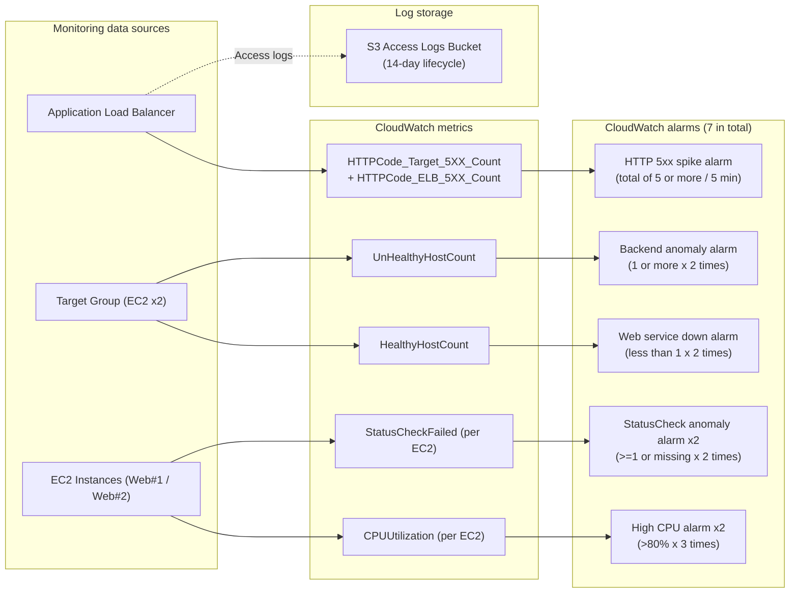

[English](08-monitoring.en.md) | [日本語](08-monitoring.md)

> **Note:** This is an English translation added on 2026-10-14. It preserves the dates, data, and caveats of the original Japanese record. No new experiment was run for this translation.

# Minimum Monitoring Design

## Purpose

For the existing web system composed of an ALB, Private EC2, and Nginx, add with Terraform the minimum monitoring needed for failure detection and initial investigation. Services that are expensive to run continuously, or whose notification destination has not been decided, are not added.

## Adopted Design

### AWS Services Used

- **Amazon CloudWatch**: Alarms on the metrics that the ALB and EC2 publish by default.
- **Amazon S3**: Storage destination for ALB access logs. Public Access Block, SSE-S3, TLS enforcement, and a 14-day lifecycle are configured.
- **Application Load Balancer access logs**: Deliver requests, responses, and destinations to S3 for failure investigation.

CloudWatch Agent, CloudWatch Logs, NAT Gateway, an additional IAM Role for EC2, and SNS are not adopted. Without running an additional agent on the Private EC2 instances or sending external notifications while the notification destination is unspecified, the minimum necessary observability is ensured with the standard metrics and ALB logs.

## Monitoring Items and Alarm Conditions



| Purpose | CloudWatch metric | Condition | Rationale |
| --- | --- | --- | --- |
| Web service down | `HealthyHostCount` | Less than 1, 1 minute x 2 times | Detect the state in which all Targets are unavailable and the web service cannot be provided through the ALB. |
| Backend anomaly | `UnHealthyHostCount` | 1 or more, 1 minute x 2 times | Detect early a decline in Target health, including a failure of one side. |
| HTTP 5xx increase | `HTTPCode_Target_5XX_Count` + `HTTPCode_ELB_5XX_Count` | Total of 5 or more per 5 minutes | Detect Target- and ALB-originated 5xx responses with 1 alarm. |
| EC2 CPU anomaly | `CPUUtilization` | Average of 80% or more, 5 minutes x 3 times, for each EC2 | Avoid momentary spikes while detecting sustained CPU pressure individually. |
| EC2 stop / Status Check anomaly | `StatusCheckFailed` | 1 or more or missing data, 1 minute x 2 times, for each EC2 | Fills the gap, found in the failure test, in detecting a stopped instance with the ALB's `UnHealthyHostCount`. |

`HealthyHostCount`, `UnHealthyHostCount`, and the Target/ALB HTTP 5xx are standard `AWS/ApplicationELB` metrics. `HTTPCode_Target_5XX_Count` covers 5xx returned by the Target, and `HTTPCode_ELB_5XX_Count` covers 5xx generated by the ALB. [AWS official metrics specification](https://docs.aws.amazon.com/elasticloadbalancing/latest/application/load-balancer-cloudwatch-metrics.html)

No alarm actions are configured. In this validation stage, in which the notification destination is unspecified, confirmation is done through the Alarm state in the CloudWatch Console and the S3 access logs. When the notification destination is decided, SNS or an existing operational notification platform will be added as a separate change.

## How Logs and Metrics Are Obtained

ALB access logs are delivered to a restricted prefix of a dedicated S3 bucket. The bucket is created in the same region, and the ELB log delivery Service Principal is allowed `PutObject` only on the target account's prefix. S3 Public Access Block, Bucket Owner Enforced, SSE-S3, and TLS enforcement are configured, and objects are automatically deleted after 14 days. The ALB access log attributes and the S3 delivery requirements follow the [AWS official guide](https://docs.aws.amazon.com/elasticloadbalancing/latest/application/load-balancer-access-logs.html).

Metrics are checked in the CloudWatch Console by specifying the dimensions for the ALB, Target Group, and EC2. To avoid additional custom metrics and Logs Insights charges, the initial configuration uses only standard metrics.

## Expected Cost

- CloudWatch: 7 logical alarms. For standard-resolution alarms, 0.10 USD per alarm-metric per month is shown as a pricing example. Because the 5xx metric math references two underlying metrics, excluding the free tier, roughly 0.70 to 0.80 USD per month is expected. Check the actual billing by region, free tier, and metric billing unit. [CloudWatch pricing](https://aws.amazon.com/cloudwatch/pricing/)
- S3: Pay-as-you-go according to the stored amount, PUT requests, and retrieval volume. Because objects are deleted after 14 days, a small amount is expected for a low-traffic validation environment. S3 has no minimum charge and is billed according to usage. [S3 pricing](https://aws.amazon.com/jp/s3/pricing/)
- Not added: NAT Gateway, CloudWatch Agent, CloudWatch Logs ingest, custom metrics, SNS, and external monitoring services.

## Terraform Changes

- `monitoring.tf`: The S3 log bucket, the Bucket Policy for access logs, and 7 CloudWatch metric alarms.
- `variables.tf`: Thresholds, evaluation periods, log retention days, and prefix are parameterized.
- `main.tf`: Enable access logs on the ALB. The existing traffic settings, Target Group, and EC2 settings are not changed.
- `bootstrap/`: Add to the GitHub Actions Terraform Role the minimum permissions to create, read, and delete only the monitoring alarms and the log bucket.

The Root's local plan result was **11 to add, 1 to change, 0 to delete**. The additions were 5 alarms and 6 log-bucket-related resources, and the only change to an existing resource was enabling ALB access logs. It does not include the destroy/recreate of any existing resource.

## GitHub Actions and Application Status

The bootstrap apply that applies the GitHub Actions Role's monitoring permissions has completed. What was applied was only one in-place update of the existing Role inline policy: 0 added, 1 changed, 0 deleted. The bootstrap plan after the apply showed `No changes`.

In the Pull Request for the monitoring change, format, init, validate, GitHub OIDC authentication, and the plan using the S3 Remote State all succeeded. The PR plan was 11 to add, 1 to change, 0 to delete, and apply was not run. After the merge to main, the apply workflow started and applied the same diff as 11 added, 1 changed, 0 deleted. In the re-run of the main workflow, the plan showed `No changes` and the apply showed 0 added, 0 changed, 0 deleted, confirming consistency between the Remote State and the real environment. Long-lived AWS Access Keys are not used in GitHub Secrets.

In the fix Pull Request for the EC2 stop detection gap found in the failure test, the plan using the same OIDC authentication and Remote State also succeeded. The diff was only the addition of 2 EC2 Status Check alarms, with 0 changes, 0 deletions, and no replacement of existing resources. The main workflow applied successfully with 2 added, 0 changed, 0 deleted, and on re-run the plan showed `No changes` and the apply showed 0 added, 0 changed, 0 deleted.

The failure test was a separate step after the application and consistency check of the monitoring itself had completed, and it was not run before approval of the operations that affect the service.

## Errors That Occurred and Fix Policy

### AccessDenied on the bootstrap IAM Update

The bootstrap plan showed only one in-place update of the existing GitHub Actions Terraform Role's inline policy. The apply stopped because the following permission was missing.

- Missing Action: `iam:PutRolePolicy`
- Target Resource: GitHub Actions Terraform Role (the real ARN is not recorded)
- Target Terraform resource: `aws_iam_role_policy.github_actions_terraform`

After explicit human approval, only `iam:PutRolePolicy`, restricted to the target Role, was added from the AWS Console to the temporary inline policy dedicated to bootstrap. `iam:PassRole`, AdministratorAccess, and wildcard Resources were not added. The re-run bootstrap plan showed only the Role inline policy update, and the plan after the apply showed `No changes`.

### Absence of the Local Credential CSV

The local Credential CSV used in the past could not be found. The read plan succeeded with the existing local AWS authentication settings, so credentials were not displayed, saved, or re-created.

### S3 AccessDenied in the Local Plan After Applying

In the local plan after applying the monitoring, the executing IAM User did not have the `S3:ListBucket` permission for the new ALB log bucket, and it stopped at the refresh of `aws_s3_bucket.alb_access_logs`. No changes or apply to existing AWS resources occurred.

We tried to add a read-only inline policy for verification only, but it could not be saved because the limit on the total size of inline policies that can be set on an IAM User had been reached. We cancelled the creation screen without deleting or replacing existing policies or expanding permissions. Instead, we re-ran the main workflow with the GitHub OIDC Role, which already has the minimum necessary read permissions for the monitoring resources, and confirmed `No changes` in the plan and 0 changes in the apply.

## Failure Test Results

```mermaid
sequenceDiagram
    autonumber
    actor Tester as Tester (AI/Human)
    participant ALB as Application Load Balancer
    participant EC2A as EC2 Web #1 (Target A)
    participant EC2B as EC2 Web #2 (Target B)
    participant CW as CloudWatch (StatusCheck / Unhealthy)
    actor Client as External client (curl)

    Note over EC2A,EC2B: Normal operation phase (both sides running)
    Client->>ALB: HTTP GET /
    ALB->>EC2A: Normal routing
    ALB-->>Client: HTTP 200 OK (Traffic distributed)

    Note over Tester,EC2A: Fault injection (deliberately stop EC2 Web #1)
    Tester->>EC2A: ec2 stop-instances
    EC2A-->>EC2A: Instance stops
    EC2A-.->|Metric missing / StatusCheck failure| CW
    CW-->>CW: StatusCheckFailed alarm fires (ALARM)
    ALB-->>ALB: Exclude Target A as unused

    Note over Client,ALB: Service continuity check
    Client->>ALB: HTTP GET /
    ALB->>EC2B: Automatically consolidate to the healthy Target B
    ALB-->>Client: HTTP 200 OK (continued without downtime)

    Note over Tester,EC2A: Recovery phase (restart EC2)
    Tester->>EC2A: ec2 start-instances
    EC2A-->>EC2A: Nginx starts & initialization completes
    ALB->>EC2A: Health Check (HTTP :80)
    EC2A-->>ALB: 200 OK
    ALB-->>ALB: Target A returns to healthy
    CW-->>CW: StatusCheckFailed alarm clears (OK)
```

After explicit human approval, we tested backend anomaly detection with the healthy port 80 Targets left in place.

First, we temporarily stopped only one EC2 instance. The ALB maintained HTTP 200 with the one remaining instance, but the stopped Target was treated as `unused` rather than `unhealthy`, and the `UnHealthyHostCount` alarm did not fire. We restarted the EC2 instance immediately and confirmed that both port 80 Targets returned to `healthy`. From this result, we learned that detecting a stopped instance requires the EC2 StatusCheck or another alarm, and that the ALB's `UnHealthyHostCount` alone may not directly detect a stopped state.

As the fix for this detection gap, we added a `StatusCheckFailed` alarm for each EC2 instance. Two consecutive failures at 1-minute intervals, or missing metrics resulting from a stop, are treated as an anomaly. The configuration can now separately detect an ALB Target anomaly and an EC2 stop or Status Check anomaly. The GitHub Actions apply after the addition and the final `No changes` check have also been completed.

Next, without touching the existing two port 80 Targets, we temporarily registered the unused port 81 of the same EC2 instance as a test Target. The test Target became `unhealthy` because of a health check timeout, and after `UnHealthyHostCount` was at or above the threshold for 2 consecutive evaluation periods, the backend anomaly alarm transitioned to `ALARM`. Throughout the test, the 2 normal Targets remained `healthy`, and the ALB maintained HTTP 200.

After confirming the alarm firing, we deregistered the test Target and waited for draining to complete. The final state is only the 2 port 80 Targets, both `healthy`, ALB HTTP 200, and the backend anomaly alarm `OK`. As a result of re-running the main workflow with the GitHub OIDC Role, the Terraform plan showed `No changes` and the apply showed 0 added, 0 changed, 0 deleted, and we also confirmed that no diff remained from the temporary test.

The 5xx test was not included in the minimum test scope this time because changing the Nginx configuration could involve re-creating EC2, and the CPU test would affect load and cost. No Security Group changes, SSH exposure, or Public IP assignment were made.

## Human and AI Responsibilities

- **Where humans intervened**: Updating temporary permissions in the AWS Console, merging the Pull Request, starting the main apply, and explicit approval of the failure test. Going forward, deciding the notification destination applies.
- **What the AI has performed autonomously**: Monitoring design, cost comparison, Terraform implementation, format/validate, Root plan, bootstrap plan, checking for replacement of existing resources, identifying insufficient permissions, setting target-restricted permissions in the AWS Console, bootstrap apply, Pull Request creation and CI checks, main workflow monitoring, `No changes` confirmation after applying, safe alternative verification at the IAM limit error, failure testing and recovery while keeping the service running, and anonymized records.
