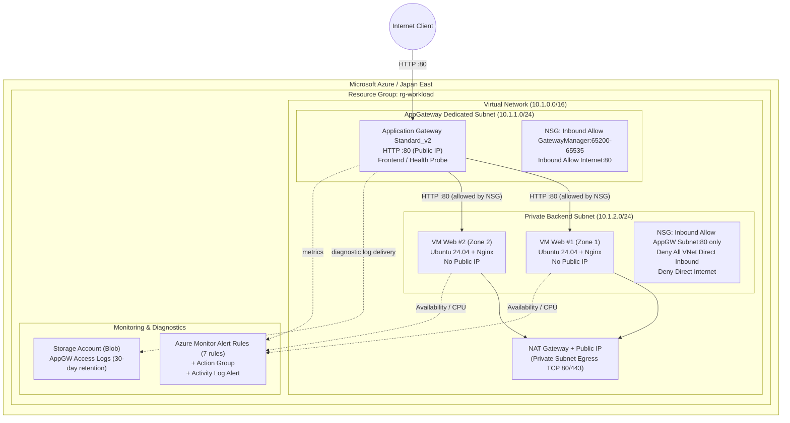

[English](02-architecture.en.md) | [日本語](02-architecture.md)

> This is an English translation added on 2026-10-14. The dates, data, and caveats of the original record are preserved. No new experiment was run for this translation.

# Azure Architecture

## Architecture Diagram

## Communication Rules and Security Boundaries

### Network Security Group (NSG) Rule Matrix

| Target Subnet / NIC | Direction | Priority | Source | Destination / Port | Action | Purpose / Notes |
|---|---|---:|---|---|---|---|
| **AppGateway Subnet** | Inbound | 100 | `Internet` | Any / TCP 80 | **Allow** | Web access from general users |
| **AppGateway Subnet** | Inbound | 110 | `GatewayManager` | Any / TCP 65200-65535 | **Allow** | Azure Application Gateway control ports |
| **AppGateway Subnet** | Inbound | 120 | `AzureLoadBalancer` | Any / Any | **Allow** | Azure infrastructure health probes |
| **Private Backend Subnet** | Inbound | 100 | `10.1.1.0/24` (AppGW Subnet) | Any / TCP 80 | **Allow** | Only traffic forwarded from Application Gateway is allowed |
| **Private Backend Subnet** | Inbound | 200 | `VirtualNetwork` | Any / Any | **Deny** | Explicitly blocks Azure's default allow-all rule within the VNet |
| **Private Backend Subnet** | Inbound | 300 | `Internet` | Any / Any | **Deny** | Blocks direct reachability from the Internet |
| **Private Backend Subnet** | Egress | 100 | Any | `Internet` / TCP 80, 443 | **Allow** (via NATGW) | For apt package updates and Nginx installation |

### Subnet Design and Routing

| Subnet name | CIDR | Associated resources | External outbound method |
|---|---|---|---|
| **`snet-appgw`** | `10.1.1.0/24` | Application Gateway Standard_v2 | Dedicated Public IP (inbound and probes) |
| **`snet-backend`** | `10.1.2.0/24` | Backend Linux VMs (Zone 1, Zone 2) | NAT Gateway + Public IP (explicit egress) |

## Azure-Specific Decisions

- **Dedicated Subnet requirement**: Application Gateway Standard_v2 requires a dedicated Subnet (`/24` recommended) that cannot be shared with VMs or other resources, so `snet-appgw` was reserved independently.
- **Explicit NAT Gateway placement**: Because implicit Default Outbound Access is deprecated and restricted for Azure Private Subnets from 2026 onward, a NAT Gateway was explicitly associated to establish the package retrieval path (apt/HTTP).
- **Overriding the default VNet allow**: The default Azure NSG rule (`AllowVnetInBound`) permits all communication within the VNet, so an explicit Deny rule was added at priority 200 to thoroughly block communication from anything other than the AppGateway Subnet.
- **Fully SSH-less, passwordless operation**: No Public IP is assigned to the VMs and no SSH port is opened; setup is completed only by automatic Nginx provisioning through a cloud-init script.
- **Low-cost diagnostic log storage**: To avoid Log Analytics workspace ingestion charges and the complexity of enabling the provider, a Blob archive in a standard Storage Account (30-day lifecycle) was adopted.
