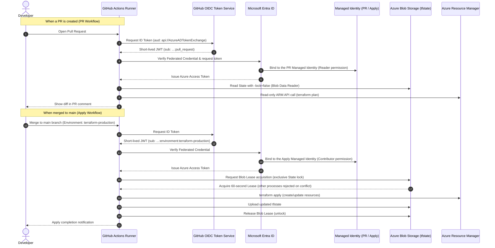

[English](07-cicd-oidc-remote-state.en.md) | [日本語](07-cicd-oidc-remote-state.md)

> This is an English translation added on 2026-10-14. The dates, data, results, and caveats of the original record are preserved. No new experiment was run for this translation. The results describe this single experiment only and are not a guarantee of reproducibility or production readiness.

# CI/CD, OIDC, and Remote State

## Adopted Design

- Backend: Azure Blob Storage
- Authentication: Microsoft Entra ID
- State locking: Blob lease
- Recovery: Blob Versioning, Blob / Container Soft Delete
- Storage Key / SAS / Client Secret: not used
- PR Identity: Reader on the target Resource Group + State Blob Data Reader
- apply Identity: Contributor on the target Resource Group + State Blob Data Contributor
- Federation subjects: limited to `pull_request` and the `terraform-production` Environment of the same repository

To keep using GitHub-hosted runners, the Storage public network endpoint is left reachable, but anonymous public access, Shared Key authentication, and container public access are prohibited.

## OIDC Authentication and Blob Lease Exclusive Control Flow

## Bootstrap Implementation Results

The following were created with Terraform in a dedicated Resource Group.

- Standard LRS Storage Account
- private Blob Container
- Blob Versioning
- Blob / Container Soft Delete (7 days)
- User Assigned Managed Identities (for PR and for apply)
- Federated Identity Credentials for GitHub Actions (for PR and for Environment)
- RBAC limited to the workload Resource Group and the State Container
- Temporary `Storage Blob Data Contributor` for the person performing the State migration

The bootstrap plan was 12 to add, 0 to change, 0 to destroy, 0 replacements, and the plan after apply was `No changes`. Storage defaults were HTTPS only, TLS 1.2 or higher, anonymous Blob access prohibited, Shared Key prohibited, and Microsoft Entra authentication. The Federation issuer was GitHub Actions, the audience was `api://AzureADTokenExchange`, and the subjects were limited to PRs and the protected Environment of the target repository.

## Local State Migration

1. Confirmed with Microsoft Entra authentication that the destination Container was empty.
2. Copied the Local State into `.state-backups/`, which is outside Git management.
3. Confirmed that the size and SHA-256 of the original State and the backup matched.
4. Configured the backend as `azurerm` with `use_azuread_auth = true`. Locally, Azure CLI user authentication was used.
5. Fixed the State Key to `terraform/azure-validation.tfstate`.
6. Migrated to Blob with `terraform init -migrate-state -force-copy`.
7. Confirmed with Microsoft Entra authentication that one State Object existed at the specified Key.
8. Confirmed that the root plan after migration was `No changes`.

Actual environment values such as the Subscription ID, Tenant ID, Storage Account name, and Client ID are not written in public documents. Backend-specific values are also kept outside Git management and are provided from GitHub Variables in CI.

## State Locking Verification in Actual Operation

With the Azure Blob lease manually acquired for only 60 seconds, the root plan was run, and it was confirmed that Terraform rejected concurrent processing with a State lock acquisition error. After the lease was reliably released, the root plan succeeded again and showed `No changes`. Unlike the S3 native lockfile in the AWS edition, the AzureRM Backend uses the lease on the State Blob itself for exclusive control.

## Permissions Used

- During migration: only `Storage Blob Data Contributor` at the State Container scope
- PR Identity: `Reader` on the workload Resource Group, `Storage Blob Data Reader` on the State Container
- apply Identity: `Contributor` on the workload Resource Group, `Storage Blob Data Contributor` on the State Container
- Storage Account Key, SAS, Client Secret: not used

The temporary RBAC for the State migration is to be deleted as a cleanup target after the CI/CD operation was confirmed.

## Human Intervention and AI Autonomous Execution

- Human intervention: specifying the Subscription to use, approving the low-cost State design that uses a public network endpoint, approving the GitHub setting changes and registration of Azure identifiers as encrypted Secrets, and identity verification via GitHub Mobile
- AI autonomous execution: bootstrap design and implementation, plan/apply, Storage security verification, Federation setting verification, Local State backup, State migration, Blob lease test, consistency checks before and after migration, and configuration of the GitHub repository, Environment, Secrets, Variables, and workflows

## GitHub Actions Design

### Pull Request

- `static-checks` runs `fmt -check`, `init` with the backend disabled, and `validate` with no Azure authentication and only `contents: read`.
- `plan` runs only for PRs originating from the same repository, and permits `id-token: write` and `contents: read` per job.
- The PR Managed Identity has only Reader on the workload Resource Group and Blob Data Reader on the State Container.
- Because the Identity is read-only, plan uses `-lock=false` and writing to the State Blob is not permitted.
- Azure login and cloud plan are not run for fork PRs.
- There is no step that applies from a PR.

### main apply

- Triggered only by a push to main.
- Uses the `terraform-production` GitHub Environment and restricts the deploy source to main only.
- Authenticates with OIDC using the apply Managed Identity and applies only the saved plan file.
- In GitHub, `ARM_USE_OIDC=true` is used, and Remote State and the AzureRM Provider are authenticated with the Federated Credential.
- Workflow concurrency is limited to one, and combined with the Azure Blob lease to prevent concurrent updates.

### Setting Names on GitHub

Encrypted Secrets:

- `AZURE_SUBSCRIPTION_ID`
- `AZURE_TENANT_ID`
- `AZURE_PR_CLIENT_ID`
- `AZURE_APPLY_CLIENT_ID` (`terraform-production` Environment)

Variables:

- `TF_STATE_STORAGE_ACCOUNT`
- `TF_STATE_RESOURCE_GROUP`
- `TF_STATE_CONTAINER`
- `SSH_PUBLIC_KEY`

Client Secret, Storage Account Key, SAS, and SSH private key are not registered.

## GitHub Actions Execution Results (Interim)

- GitHub OIDC token acquisition: succeeded
- Azure login with Entra Federated Identity: succeeded
- Azure Blob Remote State initialization: succeeded
- `terraform validate`: succeeded
- main apply workflow: succeeded as a workflow
- Long-lived credentials / Client Secret / Storage Key / SAS: not used

However, in the first successful run, the additional tag input that existed only locally was not passed to CI, and the `Purpose` tag of 12 resources was removed in place. There were no deletions, replacements, or changes to network, Identity, or Monitoring.

To prevent recurrence, the publishable `Purpose` value was moved into the default value of the Terraform variable so that local execution and GitHub Actions use the same input values. It was confirmed mechanically that the repair plan consisted only of 12 in-place tag updates, and it was applied after human approval. After the repair, the local `terraform plan` showed `No changes`.

- Human intervention: approved the apply of the 12-tag repair
- AI autonomous execution: CI log analysis, root-cause identification, unifying input values, inspecting the change scope of the plan, apply, and plan confirmation after apply

In GitHub Actions after the repair was reflected in main, GitHub OIDC Azure login, Azure Blob Remote State initialization, state lock by Blob lease, validate, plan, and apply of the saved plan all succeeded. The CI plan was `No changes` and the apply result was 0 added, 0 changed, 0 deleted, confirming that the input values of local and CI runs and the actual environment matched.

## Preventing Re-creation After Cleanup

So that the main workflow does not re-create the environment during document updates after cleanup is complete, a condition on the Repository Variable `AZURE_ENVIRONMENT_ACTIVE == 'true'` was added to the cloud plan/apply jobs. Static fmt/init/validate on PRs continue. The Variable is explicitly set to `true` only when rebuilding the environment.

The GitHub-specific Secrets, Variables, and the `terraform-production` Environment are treated as deletion candidates after Azure cleanup is complete. No automatic deletion is performed.

## Remote State / bootstrap Cleanup Results

- Root plan before cleanup: `No changes`
- Bootstrap plan before cleanup: `No changes`, using the measured OIDC subject in the State as a temporary in-memory input
- State backup: saved the Remote root state and the bootstrap local state outside Git management and confirmed the SHA-256
- root destroy: 41 deleted; confirmed State 0 and Not Found of the workload Resource Group
- bootstrap destroy: 12 deleted
- Remote State Storage / Container: deleted
- Managed Identity: 2 deleted
- Federated Identity Credential: 2 deleted
- Role Assignment: 5 deleted, 0 remaining for the deleted Identities
- State Resource Group: Not Found

After the root deletion, it was confirmed that the Remote State Blob had been updated to the final State representing the deleted root before the bootstrap was deleted. Because re-running the root plan after deleting the State Storage is not possible due to the loss of the backend, the immediately preceding State 0 and Not Found of the Azure Resource Group were used as the final consistency evidence.

## GitHub Cleanup Candidates

The existence of the following names was confirmed on the GitHub settings screen. The actual values were not retrieved or recorded. They can be deleted if there is no plan for reuse, but in this validation they were not deleted, in accordance with the user's requirements.

- Repository Secrets: `AZURE_SUBSCRIPTION_ID`, `AZURE_TENANT_ID`, `AZURE_PR_CLIENT_ID`
- Environment Secret: `AZURE_APPLY_CLIENT_ID`
- Repository Variables: `TF_STATE_STORAGE_ACCOUNT`, `TF_STATE_RESOURCE_GROUP`, `TF_STATE_CONTAINER`, `SSH_PUBLIC_KEY`
- Environment: `terraform-production` (main only)

`AZURE_ENVIRONMENT_ACTIVE` is not set, and the cloud plan/apply jobs are stopped. Static PR checks continue.
