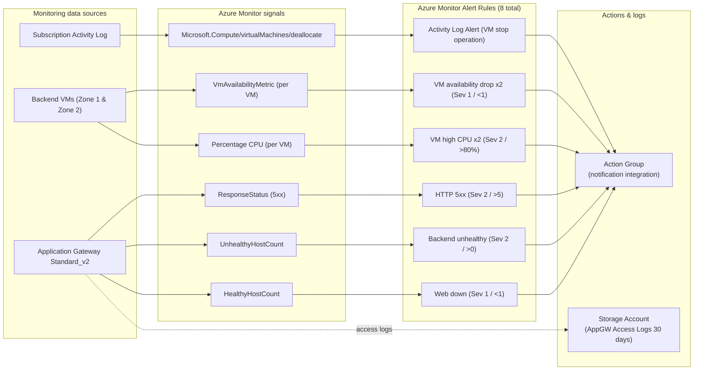
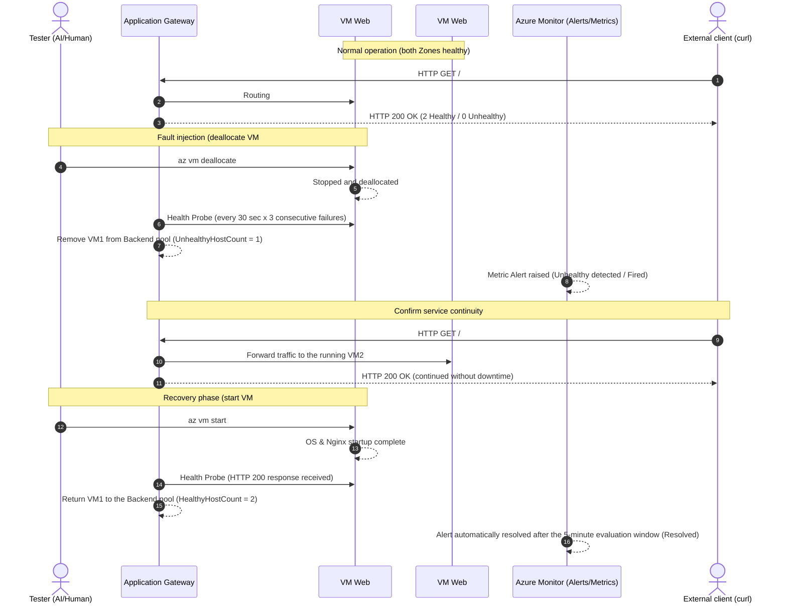

[English](08-monitoring.en.md) | [日本語](08-monitoring.md)

> This is an English translation added on 2026-10-14. The dates, data, results, and caveats of the original record are preserved. No new experiment was run for this translation. The results describe this single experiment only and are not a guarantee of reproducibility or production readiness.

# Monitoring

## Design

The design mainly uses the Azure Monitor platform metrics that the existing Application Gateway and VMs provide automatically. No detailed VM monitoring agent, VM Insights, Application Insights, or additional NAT or network configuration is added.

Only the Application Gateway access logs are saved to a dedicated Standard LRS Storage Account. The destination prohibits anonymous public access, and the Storage firewall denies everything except Azure trusted services. Because specifying a retention period in the diagnostic setting is deprecated, a Storage lifecycle policy deletes the logs after 30 days.

Log Analytics was not adopted this time. In the target Subscription, the required Resource Provider was not registered, and for a short-term validation we did not want to add a Subscription-wide setting change and log ingestion charges.

## Monitored Items

| Target | Signal | Condition | Period | Severity |
|---|---|---:|---:|---:|
| Web down | `HealthyHostCount` | less than 1 | 5 min | 1 |
| Backend unhealthy | `UnhealthyHostCount` | greater than 0 | 5 min | 2 |
| HTTP 5xx | `ResponseStatus` / `5xx` | more than 5 | 5 min | 2 |
| VM CPU | `Percentage CPU` | average above 80% | 5 min | 2 |
| VM availability | `VmAvailabilityMetric` | average less than 1 | 5 min | 1 |
| Explicit VM stop | Activity Log deallocate operation | operation occurs | event | - |

The Action Group is connected to all Alert Rules. No notification Receiver is configured, because personal information is not placed in the repository; the Fired / Resolved state is checked in Azure Monitor. In actual operation, an organization-managed notification destination should be added separately.

Standard metrics, Alert history, and the Activity Log can be checked from the Azure Portal/CLI. Application Gateway access logs are saved to the dedicated Storage. Nginx guest log collection is not included in this minimal configuration, to avoid the operational load, communication, and log volume of Azure Monitor Agent and Data Collection Rules.

## Cost

The standard platform metrics themselves need no additional collection settings. Billable items are mainly the time-series evaluation of Metric Alerts, notifications if Action Group notifications are added, and a small amount of Storage capacity and transactions. For a short-term, low-traffic validation, this is expected to be small compared with the existing Application Gateway cost, but the exact amount depends on the actual log volume and the regional pricing of Azure Monitor.

## Main Differences from the AWS Edition

- Uses Azure Monitor Metric Alerts and an Action Group instead of CloudWatch Alarms.
- For VM stops and status anomalies, combines the Azure-specific `VmAvailabilityMetric` with the Activity Log.
- Application Gateway Backend health is monitored with `HealthyHostCount` / `UnhealthyHostCount`.
- A search platform equivalent to CloudWatch Logs was not added, and a low-cost Storage archive was chosen.
- In Azure, stopping a VM from the CLI/Portal can cause the Availability Metric to be missing, so explicit deallocate operations are also covered by the Activity Log.

## Official References

- [Monitor Azure Application Gateway](https://learn.microsoft.com/azure/application-gateway/monitor-application-gateway)
- [Monitoring data reference for Azure Virtual Machines](https://learn.microsoft.com/azure/virtual-machines/monitor-vm-reference)
- [Diagnostic settings in Azure Monitor](https://learn.microsoft.com/azure/azure-monitor/platform/diagnostic-settings)
- [Azure Monitor cost and usage](https://learn.microsoft.com/azure/azure-monitor/fundamentals/cost-usage)

## Implementation and Verification Results

- `terraform fmt -check -recursive`: succeeded
- `terraform validate`: succeeded
- Local plan: 12 added, 0 changed, 0 deleted
- Plan inspection: no update / replace / destroy of existing resources
- Breakdown of additions: Action Group 1, Metric Alert 7, Activity Log Alert 1, Diagnostic Setting 1, log Storage 1, Lifecycle Policy 1
- PR workflow: fmt / init / validate / GitHub OIDC / Remote State / plan succeeded
- PR plan: 12 added, 0 changed, 0 deleted, no apply from the PR
- main apply workflow: 12 added, 0 changed, 0 deleted with GitHub OIDC
- Local plan after apply: `No changes`

## Failure Test

Only 1 of the 2 Backend VMs was deallocated, and the other was kept running.

| Check item | Result |
|---|---|
| Before the stop | HTTP 200, Backend 2 Healthy / 0 Unhealthy |
| After stopping 1 VM | HTTP 200, Backend 1 Healthy / 1 Unhealthy |
| Stop operation | Recorded in the Azure Activity Log |
| Metric Alert | Transitioned from Healthy to Unhealthy (equivalent to Fired) |
| After VM restart | HTTP 200, Backend 2 Healthy / 0 Unhealthy |
| Metrics after recovery | `UnhealthyHostCount` returned to 0 |
| Alert auto-resolution | Transitioned from Unhealthy to Healthy (equivalent to Resolved) |

The Health Probe judges the Backend as unhealthy after 3 failures at 30-second intervals. The Metric Alert is evaluated at 1-minute intervals over a 5-minute window, so we confirmed the Azure-specific behavior in which the Fired/Resolved display lags behind the change in Backend health.

## Human Intervention and AI Autonomous Decisions

- Human intervention: presenting validation requirements including the addition of monitoring and safe failure testing
- AI autonomous decision: not adopting Log Analytics and choosing a dedicated Storage archive
- AI autonomous execution: Terraform implementation, static verification, plan safety inspection, PR creation, CI confirmation, merge, apply monitoring, the 1-VM stop test, recovery, and Alert state confirmation
- Permission expansion: none

## Problems Encountered

- On Windows, the JMESPath expression of the Azure CLI was interpreted by the command shell, and a pre-check command failed. No changes occurred on the Azure side. The approach was changed to retrieve the JSON and filter it on the PowerShell side, and the check then worked correctly.
- Creating the Metric Alert took about 2 minutes, and reflecting the fault and recovery states took the evaluation window plus additional propagation delay. This is behavior due to the Azure Monitor evaluation cycle, not an error.

## Cleanup

The Diagnostic Setting, 7 Metric Alerts, Activity Log Alert, Action Group, Monitoring Storage, and Lifecycle Policy were deleted by the root Terraform destroy. After cleanup, it was confirmed by read-only checks against Azure that the validation workload Resource Group and the validation-tagged monitoring resources were 0.
