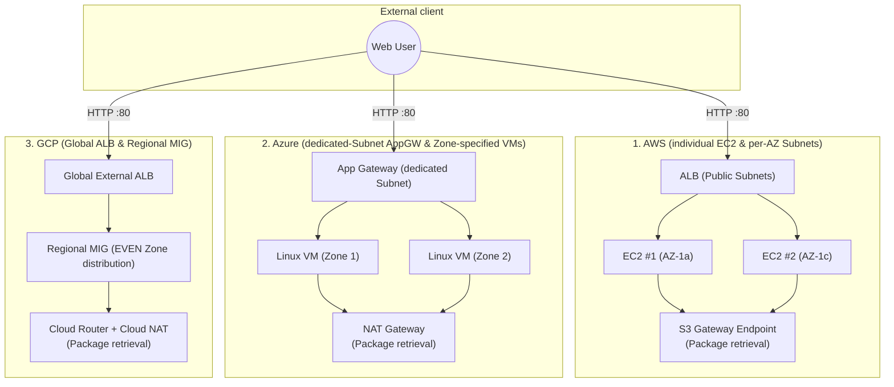
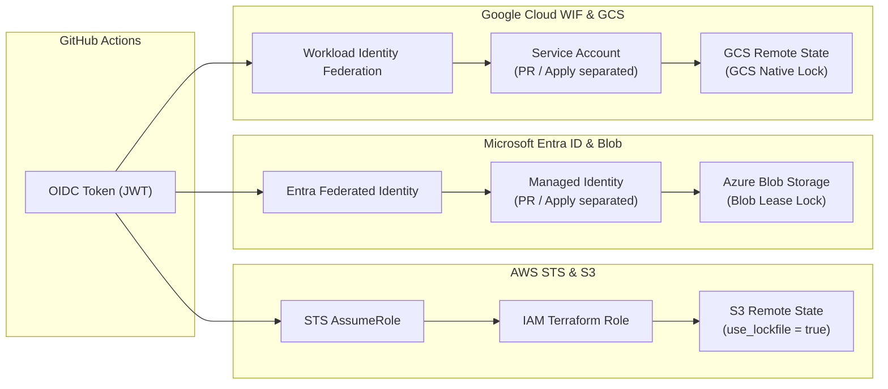
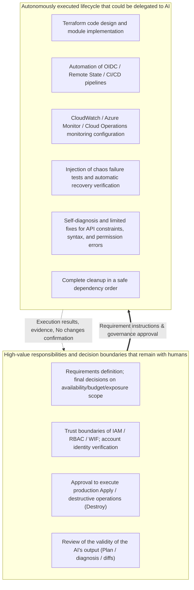

# How Far Can AI Take Three-Cloud Implementation?
## AWS / Azure / GCP Cross-Lifecycle Validation: Final Report

[English](final-report.en.md) | [日本語](final-report.md)

> **Translation note**: This is an English translation added on 2026-10-14. It preserves the source record's dates, data, and caveats. No new experiment was run. The report remains a historical static review: findings described as open here (for example in Section 8) are reported as they were at the time of the review, even if the code was changed later.

Created: 2026-09-08 (Japan time)

## 1. Conclusion

**In this Level 2-equivalent validation, a human set the overall design, safety boundaries, review points, and approval points, and Codex then completed, as the main actor, the concrete implementation of and technical troubleshooting for component selection, Terraform implementation, CI/CD, short-lived authentication, Remote State, monitoring, failure testing, recovery, and cleanup.** (2026-10-14 clarification: the original phrase "AI-led from design" should be read as: the overall design by the human; component selection, concrete implementation, and technical troubleshooting by Codex. See Section 2.)

The value was not only in the initial code generation. Faced with API and provider constraints, authentication claim mismatches, partial applies, input differences, and propagation delays in deletion, the AI investigated the causes, limited the diffs and fixed them, and confirmed that the state converged. In the execution records, all three environments completed deletion of managed resources and confirmation that none remained. [A1](aws/09-final-results-and-cleanup.en.md)[Z1](azure/05-results.en.md)[G1](gcp/05-results.en.md)

This result shows that AI can absorb a considerable portion of the differences between cloud-specific APIs and Terraform syntax. On the other hand, the requirements, scope, acceptable range of IAM, acceptance of public exposure and cost, identity verification, and approval of destructive operations remained with the human. Human expertise was needed to evaluate the AI's output and to decide the boundaries within which execution was acceptable.

However, **completion of the experiment and the ability to re-run the current code as is are separate assessments.** The code review in this report found items that must be resolved for reproduction, such as an inconsistency between the AWS Terraform version and S3 locking. This is not grounds to deny the execution records, but reproducibility cannot be guaranteed unconditionally either (Section 8).

## 2. Experiment Scope and Evaluation Method

"Level 2" in this report is a validation category set with reference to the progression of each cloud vendor's certification framework; this validation dealt with a standard web platform and its operations lifecycle. The design intent and its relation to certifications are supplemented below.

**Definition of certification-inspired levels and experiment design (clarification: 2026-10-14)** The clarification in this section corrects the explanation of the existing experiment. The creation date (2026-09-08), figures, comparison tables, evidence, referenced commits, and experiment records have not been changed.

Levels 1–3 in this validation are validation categories inspired by the progression seen in each cloud vendor's certification framework: Level 1 is foundational, Level 2 is intermediate with a focus on administration and implementation, and Level 3 is more advanced architect design and decision-making. Level 2 draws on the domains covered by certifications such as [Azure Administrator Associate](https://learn.microsoft.com/en-us/credentials/certifications/azure-administrator/), [AWS Solutions Architect – Associate](https://aws.amazon.com/certification/certified-solutions-architect-associate/), and [Google Cloud Associate Cloud Engineer](https://cloud.google.com/learn/certification/cloud-engineer). The vendors' certification frameworks and scopes differ, and these labels do not represent an official cross-vendor level, complete coverage of exam scope, or equivalence to any certification. As references when considering the more advanced architect level, there are [AWS Solutions Architect – Professional](https://aws.amazon.com/certification/certified-solutions-architect-professional/), [Azure Solutions Architect Expert](https://learn.microsoft.com/en-us/credentials/certifications/azure-solutions-architect/), [Google Cloud Professional Cloud Architect](https://cloud.google.com/learn/certification/cloud-architect), and the [Google Cloud certification overview](https://cloud.google.com/learn/certification).

Experiment design: The owner did the overall design. They defined an IaaS configuration of LB + 2 VMs + network connectivity, and made monitoring, chaos testing, fault tolerance, and API operation requirements. Codex selected the concrete AWS/Azure/GCP components and carried out nearly all of the build and technical troubleshooting. The owner designed the process so that AWS results, tickets, and know-how were carried into Azure, and Azure's successes and failures were carried into GCP.

The common requirements were: serve HTTP from an L7 load balancer to 2 Private VMs; provide no VM Public IP or Internet-facing SSH; and confirm Terraform, GitHub Actions, Federation without long-lived keys, Remote State, minimal monitoring, safe failure testing, and deletion. The work was carried out in the order AWS, Azure, GCP, with lessons from each earlier stage carried into the later ones. [A1](aws/09-final-results-and-cleanup.en.md)[Z1](azure/05-results.en.md)[G1](gcp/05-results.en.md)

This report is a post-hoc analysis that cross-checks the implementation of each repository against the published execution records. It did not reconnect to the clouds, apply, inject failures, or destroy. Because the original State and the full command logs are not published, recorded successes are treated as "confirmation from execution records," states that can be understood from code as "static review," and interpretations drawn from them as "discussion."

| Evaluation aspect | Evidence for judging completion |
|---|---|
| Build | In addition to apply completion, HTTP 200 via the LB and healthy Backend |
| Authentication / CI/CD | Short-lived authentication from GitHub, Remote State initialization, plan/apply |
| State consistency | No changes after migration, after fixes, and after failure recovery |
| Monitoring | Creation of definitions, and alert firing and resolution for the selected failure |
| Cleanup | delete-only plan, State 0, confirmation by API etc. that the targets no longer remain |
| Safety boundaries | Preservation of existing environments, stopping when permissions were insufficient, required approvals |

## 3. Architecture and Implementation Comparison

### Comparison of the architecture patterns of the three clouds

### Comparison of OIDC authentication and Remote State exclusive-control methods

| Item | AWS | Azure | GCP |
|---|---|---|---|
| Region | Tokyo | Japan East | Tokyo |
| L7 exposure | Regional ALB | Application Gateway Standard_v2 | Global External Application Load Balancer |
| Backend | 2 standalone EC2 instances | 2 Zone-specified Linux VMs | Instance Template + 2 instances in a Regional MIG |
| Zone design | Subnet per AZ | VM Zones specified within a Regional Subnet | MIG distributed across 2 Zones within a Regional Subnet |
| Private outbound | Package retrieval via S3 Gateway Endpoint | NAT Gateway | Cloud Router + Cloud NAT |
| Backend inbound restriction | HTTP from the ALB's SG | HTTP from the App Gateway Subnet | HTTP from GFE / Health Check ranges |
| Federation | IAM OIDC Provider + STS Role | Entra Federated Credential + Managed Identity | WIF Pool/Provider + SA impersonation |
| PR / apply Identity | Uses the same IAM Role | Separate Managed Identities | Separate Service Accounts |
| Remote State | S3 | Azure Blob | GCS |
| Locking | S3 native lockfile as designed and recorded; version inconsistency exists | Blob lease. Demonstrated rejection of conflicts and recovery after release | Standard GCS backend locking |
| Locking during PR | Lock is not disabled | `-lock=false` | `-lock=false` |
| Monitoring | 7 CloudWatch Alarms | 7 Metric Alerts, 1 Activity Log Alert, Action Group | 1 Uptime Check, 5 Alert Policies, 1 log-based metric |
| Logs | Dedicated S3, designed with 14-day retention | Dedicated Storage, designed with 30-day retention | Project-default Cloud Logging |
| Cleanup boundary | State + tag + known names | State + Resource Group | State + label + known names. Project retained |

Basis: the configuration, monitoring, bootstrap, and workflows of each cloud. [A2](aws/08-monitoring.en.md)[A3](../aws/bootstrap/main.tf)[A4](../.github/workflows/aws-pr.yml)[Z2](azure/08-monitoring.en.md)[Z3](../azure/bootstrap/main.tf)[Z4](../.github/workflows/azure-pr.yml)[G2](gcp/08-monitoring.en.md)[G3](../gcp/bootstrap)[G4](../.github/workflows/gcp-pr.yml)

Even though they implement the same requirements, the configurations are not identical. GCP includes self-healing through the MIG, whereas AWS/Azure manage individual VMs. GCP's Global LB also does not mean that the backends were made multi-region. The AWS configuration without NAT depends on the retrieval path of the chosen OS, and differs from a design that can access general external repositories.

### Difficulties observed this time

The following is a qualitative assessment from this experiment and is not a difficulty ranking of the services as a whole.

| Item | AWS | Azure | GCP |
|---|---|---|---|
| Terraform implementation | Dependency between egress and startup processing; replacement diff caused by line endings | Provider attributes, Probe Host, Service Tag constraints | The root build succeeded the first time. Fixed bootstrap type conversion and the Monitoring API |
| Identity | Repeated tuning of the IAM Actions required for refresh/create/delete | Isolating Identity, Federated Credential, RBAC scope, and backend authentication method | Multi-step isolation of mapping, condition, exact subject, and SA IAM |
| Remote State | object/version/lockfile permissions and migration/deletion order | Separating CLI User and CI OIDC authentication | CI had no backend declaration, and the plan showed the existing environment as 18 adds |
| Cleanup | Deleting all versions, IAM limits, deletion API permissions, waiting for propagation | RG boundary is clear. Propagation delay in App Gateway deletion | root → bootstrap order, 1 attempt each. Distinguishing existing resources from soft-delete |

## 4. Quantitative Results and Cautions in Aggregation

### Visualization of managed resource counts and cleanup results

```mermaid
xychart-beta
    title "Terraform-managed resource counts of the 3 clouds (Root vs Bootstrap)"
    x-axis ["AWS", "Azure", "GCP"]
    y-axis "Number of resources (count)" 0 --> 50
    bar [39, 41, 25]
    bar [9, 12, 13]
```

- **AWS**: Root 39 + Bootstrap 9 = 48 resources in total (`██████████ 100% deleted / 0 remaining`)
- **Azure**: Root 41 + Bootstrap 12 = 53 resources in total (`██████████ 100% deleted / 0 remaining`)
- **GCP**: Root 25 + Bootstrap 13 = 38 resources in total (`██████████ 100% deleted / active 0`)

| Metric | AWS | Azure | GCP |
|---|---:|---:|---:|
| Until the first root safe plan | No aggregate on the same definition | 2 times | 1 time |
| Until the first bootstrap safe plan | No aggregate on the same definition | Not aggregated | 4 times |
| Until the first root apply completed | No aggregate on the same definition | 2 times | 1 time |
| No changes confirmations | Multiple times. Total not aggregated | At least 11 times | 13 |
| Unintended real-environment diffs | Total not aggregated | 1 time, deletion of additional tags on 12 resources | 0 drift |
| Example of dangerous plan | EC2 replacement diff due to CRLF | Tag update due to input differences | 18 adds due to missing backend |
| Unexpected destroy / replace | No total on a unified definition | 0 executions in the build and fix aggregation | 0 |
| Human intervention (aggregated in the original records) | 8 categories | 5 categories | 4 items |
| Cleanup root | 39 | 41 | 25 |
| Cleanup bootstrap | 9 | 12 | 13 |
| After deletion | No managed-target remnants | 0 managed-target remnants | 0 managed-target active |

The figures are transcribed from [A1](aws/09-final-results-and-cleanup.en.md)[Z1](azure/05-results.en.md)[G1](gcp/05-results.en.md). The total of 139 is the number of deleted Terraform-managed items (48 + 53 + 38); it is not the number of VMs or the number of independently billed resources. Because GCP's VMs are managed by the MIG, the scale of the configurations cannot be compared by the Terraform item count alone.

- **A single safe plan applies only to GCP's first root.** The bootstrap took 4, including 2 CLI parsing failures and 1 type error. Monitoring also had a partial apply and fixes.
- **Drift 0 does not mean there were no erroneous plans.** GCP stopped the 18-add inconsistency before apply. Intentional temporary diffs from reducing the MIG are not included in the tally of unintended drift.
- **Unexpected replace 0 does not mean replacement itself was 0.** For GCP's PR/Apply WIF bindings, approved replacements were carried out, one each.
- **8→5→4 cannot be calculated as a reduction rate in intervention counts.** AWS/Azure are categories; GCP is 4 recorded approvals and identity verifications. The GCP monitoring document also separately records execution approvals, so it is not asserted that the approvals across the whole lifecycle were only 4.
- GCP's Monitoring is stated as "4 attempts" in the result aggregation and as "the 3rd main apply" in the monitoring details. Because the correspondence between runs and attempts etc. is not made explicit, no unified success rate or number of attempts is newly calculated.
- Azure's "executed destroy / replace 0" is not 0 deletions over the entire period including the intended cleanup. For AWS, EC2 recreation is recorded for fixing an initial defect.
- The number of No changes depends on the number of opportunities for confirmation. Do not convert 13 directly into a quality score or success rate.

## 5. What We Learned from AI's Failures and Recoveries

| Event | Impact on the real environment / detection stage | AI's response and the lesson that remains |
|---|---|---|
| AWS: insufficient egress for package retrieval | Nginx installation failed, ALB 502 | Recovered by allowing 443 to the S3 Prefix List. Design Private placement and startup-time dependencies together |
| AWS: insufficient bootstrap permissions | AccessDenied, partial creation | Cross-checked the missing Actions/Resources against State. Permission additions were limited and under human approval |
| AWS: user_data diff caused by CRLF | EC2 replacement plan | Unified to LF. File normalization in local/CI is also part of IaC reproducibility |
| Azure: outdated attributes, Probe, DNS rules | validate/plan failure, partial apply after 29 resources were created | Checked the provider schema/API and fixed the invalid settings. The plausibility of generated code is not sufficient grounds |
| Azure: CLI warning leaked into a GitHub Variable | Detected before the CI run | Validated the output and entered it as a single value. The boundary between stdout/stderr and machine input matters |
| Azure: tags input differed between local and CI | Additional tags on 12 resources were actually deleted | Unified the input and repaired only the tags after approval. Even a normally completed apply may go against intent |
| GCP: backend declaration not tracked in Git | PR treated the existing 18 resources as new creations | Tracked the empty GCS backend declaration. Repaired without applying |
| All 3 clouds: OIDC subject assumption mismatch | Authentication failure | Cross-checked the actual claim against the trust condition. In GCP, replaced an approved binding. Falling back to long-lived keys or broad trust conditions was unnecessary |
| GCP: Monitoring API constraints | 400 after partial creation | Fixed duration/comparison/resource mapping. Re-planned only the resources not yet created |
| Azure: cleanup propagation delay | Temporary rejection of NSG Rule deletion | Confirmed 3 remaining items and regenerated the delete-only plan. Converged without forcibly manipulating State |

Basis: [A1](aws/09-final-results-and-cleanup.en.md)[Z5](azure/04-troubleshooting.en.md)[G5](gcp/04-troubleshooting.en.md).

None of these events can be attributed solely to a lack of AI capability. Errors in generated code, the local environment, authentication settings, and the asynchronous nature of clouds are mixed together. What should be evaluated is not only the number of problems that occurred, but whether the impact was contained, the approval boundaries were kept, and the state converged.

"Do not automatically expand permissions" also does not mean "no permission changes at all during the validation period." AWS added Actions under approval, and GCP recorded added bindings for the initial bootstrap and the VM execution Identity. Fixing an authentication condition and expanding permissions must also be distinguished.

## 6. What Was Reached in Monitoring and Failure Testing

| Cloud | Failure performed | What could be observed | Not confirmed / out of scope |
|---|---|---|---|
| AWS | After stopping EC2, temporarily registered an unused port 81 Target | Found a detection gap in which a stopped Target becomes unused. ALARM→OK on port 81, HTTP 200 maintained | Re-firing of the additional StatusCheck alarm on re-stop is unconfirmed in the records. Real CPU/5xx firing and external notifications were not tested |
| Azure | Deallocated 1 VM | Backend abnormality, Fired-equivalent→Resolved-equivalent, HTTP 200 maintained | Individual firing of every monitoring rule and delivery via the notification Receiver are unconfirmed |
| GCP | MIG target size 2→1→2 | Capacity decrease, Incident Open→Closed, 2 instances Healthy again, HTTP 200 maintained | Firing of the Health Check Alert is unconfirmed. This is not a test of all rules or external notifications |

Basis: [A2](aws/08-monitoring.en.md)[Z2](azure/08-monitoring.en.md)[G2](gcp/08-monitoring.en.md).

Going a step beyond "monitoring could be built," we were able to confirm actual signals, alert states, service continuity, and consistency after recovery. However, because different failures were used, this is not an experiment that ranks detection speed or availability across clouds. No notification destination was configured in any of them, so this is not a production-operations validation that includes notifications reaching the person in charge.

## 7. Cleanup and the Meaning of "0 Remaining"

Deletion was a process that required design, approval, and verification, just like creation.

| Item | AWS | Azure | GCP |
|---|---|---|---|
| Procedure | root → all State versions → bootstrap and temporary IAM | root → confirm empty State → bootstrap | root → confirm empty State → bootstrap |
| Notable points | Deleted all 12 State versions; adjusted the IAM character limit and deletion permissions | After the App Gateway propagation delay, re-ran only the 3 remaining items | Deleted root 25 and bootstrap 13, 1 attempt each |
| Boundary protection | Retained resources used for other purposes and existing managed policies | Retained Resource Groups outside the validation | Retained the Project, the existing default network, and 2 existing SAs |
| CI after cleanup | State/OIDC deleted. No explicit ACTIVE gate | ACTIVE gate present | ACTIVE=false; Skipped cloud jobs recorded |

Basis: [A1](aws/09-final-results-and-cleanup.en.md)[Z1](azure/05-results.en.md)[G1](gcp/05-results.en.md) and static confirmation of the workflows. [A4](../.github/workflows/aws-pr.yml)[Z4](../.github/workflows/azure-pr.yml)[G4](../.github/workflows/gcp-pr.yml)

0 remaining means that **no active resources of the targets managed in the validation remain.** It is not a guarantee that the entire account is empty, that soft-deleted resources have been physically erased, that retained logs have been wholly erased, or that there will be no billing at a later date. GCP's Project-default Logging bucket was also not a deletion target. This report reviewed published records and did not re-query the current cloud remnants.

On cost, only AWS has an approximate figure of about 0.25 USD for related services recorded, but it is not a strict tag-based allocation. Because there are no measurements under the same conditions for Azure/GCP, no cost ranking or cost reduction rate is calculated. [A1](aws/09-final-results-and-cleanup.en.md)

## 8. Reproducibility and Governance Issues Found in the Final Code Review

### 8.1 AWS S3 locking and the Terraform version

AWS's `backend.tf.example` has `use_lockfile = true`, but both workflows specify Terraform 1.9.8, and the root `required_version` also allows 1.8 and later. [A3](../aws/bootstrap/main.tf)[A4](../.github/workflows/aws-pr.yml)

S3 native locking is a feature introduced in Terraform 1.10.0. [H1](https://github.com/hashicorp/terraform/blob/v1.10.0/CHANGELOG.md) Therefore, the current version specification and backend setting are inconsistent. Past success records cannot be treated as reproduced success on the current checkout; before re-validation, the versions must be aligned to a supporting version, and the executed version and logs must be recorded. No implementation was changed in producing this report.

### 8.2 AWS PRs are not read-only in terms of permissions

AWS's PR and apply use the Role in the same repository Variable, and the bootstrap also trusts both subjects with the same Role. [A3](../aws/bootstrap/main.tf)[A4](../.github/workflows/aws-pr.yml) Even if the command executed in a PR is only plan, that is different from the Identity's permissions being read-only. In Azure/GCP, the PR and apply Identities and permissions are separated.

### 8.3 Approval and the saved plan

On all three clouds, the main job generates the plan and applies it. An Environment specification can be confirmed, but the YAML alone cannot confirm the actual settings such as required reviewers. Also, the configuration is not one in which the very plan viewed in the PR is carried over to main and approved. [A4](../.github/workflows/aws-pr.yml)[Z4](../.github/workflows/azure-pr.yml)[G4](../.github/workflows/gcp-pr.yml)

Therefore, a mechanism by which "a human always reviewed that saved plan after generation" cannot be proven. When reusing this, it must be made clear how the plan subject to approval is matched to the plan actually applied.

### 8.4 Locking, CI stopping, and validation order

Azure/GCP use `-lock=false` to limit the PR's State read permissions, and do not disable locking on the apply side. Even when standard locking is adopted, not every plan takes the lock. [Z4](../.github/workflows/azure-pr.yml)[G4](../.github/workflows/gcp-pr.yml)

AWS has no environment-activation gate equivalent to Azure/GCP's, and is configured to stop by depending on authentication and State that have been deleted. GCP's cloud-plan job has no `needs` on static-checks, so it is not structured to wait for completion of static validation. Separately from this completion record, these remain as governance improvement points before the next use.

## 9. How to Interpret GCP's Stabilization

GCP achieved the first-time root safe plan success, unintended drift 0, No changes 13 times, and cleanup once each. Azure's retrospective states an approach of improving, in the next stage, input-value unification, advance checking of OIDC claims, cleanup dependency order, environment-activation flags, and the monitoring evaluation window. [Z6](azure/06-lessons-learned.en.md)[G1](gcp/05-results.en.md)

Of these, the suppression of input differences, cleanup order, and environment-activation gate also appear in GCP's implementation and results. On the other hand, OIDC subject mismatch also occurred in GCP, so carrying over the lessons did not prevent every failure.

**What this experiment can support is the practical implication that an approach of reflecting earlier-stage failures into the design and confirmation procedures was effective.** Because this was a single operator and a sequential experiment, and the requirements, configurations, and instructions to the AI were not completely fixed, the improvement cannot be attributed solely to the ease of GCP itself or to an improvement in the AI model's capability. [G6](gcp/06-lessons-learned.en.md)

**The owner's observation and its limits (clarification: 2026-10-14)** The owner observes that build speed gradually increased. This is the owner's observation; it is not a controlled causal proof, model learning itself, or proof of job replacement. The caveat about confounding in the sequential experiment above remains unchanged.

## 10. What Remains for Cloud Engineers in the AI Era

| Responsibility / task | Scope delegated to AI this time | Judgments that remain with humans |
|---|---|---|
| Requirements / design | Structuring requirements, proposing service selection, concretizing in Terraform | Decide availability, budget, exposure scope, and what is out of scope |
| Identity | Policy/binding proposals, claim cross-checking, root-cause analysis | Accept the permissions and trust boundaries of IAM/RBAC/WIF |
| Implementation / changes | Code, CI, State migration, diff analysis, limited fixes | Approve application, destruction, and service impact |
| Incident response | Investigating metrics and logs, recovery proposals, execution and confirmation | Judge acceptable downtime and business impact |
| Cleanup | Dependency order, delete-only plan, remnant reconciliation | Determine which resources may be deleted and which must be retained |
| Quality assurance | Provider/API research, testing, documentation | Review deprecated specifications, design validity, and insufficient evidence |

This is not a conclusion that cloud-specific knowledge becomes unnecessary. This time too, without understanding the differences among SG/NSG/Firewall, Trust and Permission, Control Plane and Data Plane, State and the real resources, and firing and notification, it would not have been possible to judge whether the AI's proposals satisfied the requirements.

The shift in value that this result shows is a shift in weight from the work of memorizing APIs and commands and operating one by one, to the work of **defining requirements and constraints, reviewing the designs, diffs, and evidence the AI presents, and taking responsibility for the results.** The more broadly AI takes on implementation, the more important becomes the ability to define what counts as success, what is prohibited, and when to stop.

**Supplementary lesson (2026-10-14)** The overall design, IAM permissions, monitoring policy, and credential boundaries must be understood, designed, and configured by a human. This time, the AI implemented concrete Policies and monitoring definitions, but that does not mean the AI took responsibility for the policies and boundaries. The role of implementation and the responsibility for policies and boundaries are treated as distinct.

## 11. Scope of Applicability of the Conclusion

What could be confirmed this time is success in three short-term, small-scale, disposable environments in which an experienced cloud engineer set the safety boundaries.

The following are unverified, and are not to be inferred from this success.

- Advantage in time, cost, and quality over a human-only implementation. There is no unified measurement of time, tokens, or operation effort.
- Whether a beginner can reach the same result. The owner has design and review experience.
- Success rates over multiple independent re-experiments, and comparison between models. There is no unified record of model versions, all prompts, or all logs.
- Production TLS, WAF, notification delivery, SLOs, long-term operation, DB/data migration, recovery drills, multi-region DR, and large-scale governance.
- Unmodified reproduction of the current code. Re-execution after resolving the inconsistencies in Section 8 has not been performed.

**The final evaluation is: "The defined Level 2 validation was completed on all three clouds. The AI-led implementation and operations lifecycle was demonstrated, but production suitability and reproducibility of the current code require separate confirmation."**

## 12. Evidence and Referenced Commits

The main branch as it was before this report was added is pinned for reference. The link targets are the commits at the time of confirmation, not the main that keeps being updated. The numbers of execution results are taken from each results document, and unrecorded numbers have not been supplemented.

| Cloud | Confirmed commit |
|---|---|
| AWS | `c5e5ab86aa701034347971ed52d6876bcee3594d` |
| Azure | `b5344c6c6ca9b2220c132137ed5bc26dd08b6753` |
| GCP | `8fbc809bd787d46801d7ff8e030eb40c0db4b35d` |

- A1: [AWS final results, intervention aggregation, and Cleanup](aws/09-final-results-and-cleanup.en.md)
- A2: [AWS monitoring and failure testing](aws/08-monitoring.en.md)
- A3: [AWS bootstrap / IAM](../aws/bootstrap/main.tf)
- A4: [AWS workflows](../.github/workflows/aws-pr.yml)
- Z1: [Azure execution results, aggregation, and Cleanup](azure/05-results.en.md)
- Z2: [Azure monitoring and failure testing](azure/08-monitoring.en.md)
- Z3: [Azure bootstrap / RBAC](../azure/bootstrap/main.tf)
- Z4: [Azure workflows](../.github/workflows/azure-pr.yml)
- Z5: [Azure failure records](azure/04-troubleshooting.en.md)
- Z6: [Azure lessons learned and improvements for GCP](azure/06-lessons-learned.en.md)
- G1: [GCP execution results, aggregation, and Cleanup](gcp/05-results.en.md)
- G2: [GCP monitoring and failure testing](gcp/08-monitoring.en.md)
- G3: [GCP bootstrap / WIF / IAM](../gcp/bootstrap)
- G4: [GCP workflows](../.github/workflows/gcp-pr.yml)
- G5: [GCP failure records](gcp/04-troubleshooting.en.md)
- G6: [GCP lessons learned and final evaluation](gcp/06-lessons-learned.en.md)
- H1: [HashiCorp Terraform 1.10.0 CHANGELOG (introduction of S3 native state locking)](https://github.com/hashicorp/terraform/blob/v1.10.0/CHANGELOG.md)

- [AWS configuration code](../aws/)

- [AZURE configuration code](../azure/)

- [GCP configuration code](../gcp/)
