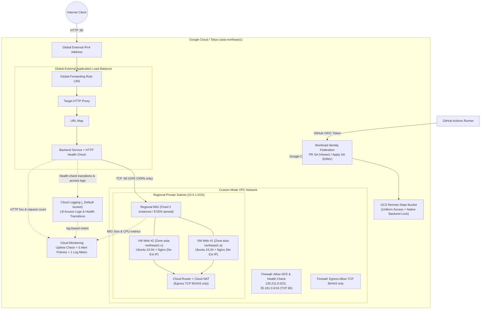

[English](02-architecture.en.md) | [日本語](02-architecture.md)

> This is an English translation added on 2026-10-14. It preserves the dates, data and caveats of the source record (Japanese original). No new experiment was run.

# GCP Architecture

## Architecture Diagram

This diagram color-codes web requests, VM package retrieval, and monitoring/control traffic, and shows the overall configuration at validation time, including the Terraform delivery path and Remote State. The CIDRs and sizes in the diagram are repository defaults; environment-specific values such as the real Project ID, Public IP, Service Account, and State Bucket name are not shown.

### Communication and Scope of Responsibility

- HTTP from the Internet is accepted only by the Global External Application Load Balancer, which forwards it to the Regional MIG through the URL map and Backend service.
- The MIG places Private VMs in 2 Zones of the Tokyo region and maintains the Backend with Health Check and autohealing. VMs have no External IP, and SSH from the Internet is not allowed.
- TCP 80 to the Backend is allowed only from the GFE / Health Check source ranges. Package retrieval from VMs is limited to TCP 80/443 via Cloud NAT.
- LB access logs and health-check transitions are stored in Cloud Logging, and the Uptime Check, native metrics, and log-based metric are evaluated by 5 Alert Policies.
- GitHub Actions exchanges OIDC with Workload Identity Federation, with separate Service Accounts for PR and Apply. No long-lived keys are used, and State is protected by GCS versioning and native locking.
- Build, HTTP 200, Monitoring, failure recovery, and cleanup have been verified, and the validation resources in the cloud are now deleted. The Terraform code is retained for reproduction.

### Detailed Mermaid Diagram

## Communication Rules and Firewall Boundaries

### Firewall Rule Matrix

| Rule name | Direction | Priority | Source / Destination | Target tag / Scope | Protocol / Port | Action | Purpose / Notes |
|---|---|---:|---|---|---|---|---|
| **`allow-gfe-and-health-check`** | Ingress | 1000 | `130.211.0.0/22` `35.191.0.0/16` | `http-server` (MIG VM) | TCP / 80 | **Allow** | Inbound from Google Front End (GFE) and health checkers |
| **Default Inbound** | Ingress | 65535 | `0.0.0.0/0` | All instances | Any | **Deny** | Blocks direct reachability from the Internet (including SSH 22) |
| **`allow-egress-packages`** | Egress | 1000 | `http-server` (MIG VM) | `0.0.0.0/0` | TCP / 80, 443 | **Allow** | apt updates and Nginx package retrieval via Cloud NAT |
| **`deny-other-egress`** | Egress | 2000 | `http-server` (MIG VM) | `0.0.0.0/0` | Any | **Deny** | Blocks unnecessary external communication other than Web package retrieval |

### Network Design Points

| Item | Design | Reason / Benefit |
|---|---|---|
| **VPC mode** | Custom Mode VPC | Eliminates the allow-all rules of the Default VPC and builds a least-privilege network |
| **Subnet structure** | Single Regional Subnet (`10.0.1.0/24`) | A GCP Subnet spans the whole region, so there is no need to split Subnets per AZ |
| **Outbound** | Cloud Router + Cloud NAT | VMs have no External IP; only the minimum ports (80/443) go out through NAT |
| **Load balancer** | Global External ALB (HTTP) | Terminates at Google's edge PoPs and forwards with low latency over Google's backbone to the MIG in the Tokyo region |

## GCP-Specific Decisions

- **Subnets are region-wide in scope**: Unlike AWS and Azure, there is no need to create a Subnet per AZ; instances can be placed in multiple Zones (Zone A, Zone C) within one Regional Subnet.
- **Self-healing with a Regional MIG**: Rather than building fixed VMs individually, even Zone distribution (`EVEN`) and health-check-driven automatic restart (Auto-healing) are managed together from Terraform with a Regional Managed Instance Group.
- **Adoption of the Global External ALB**: Traffic is accepted at Google's global edge network from wherever it originates, and consolidated and forwarded through the URL map and Backend service.
- **Backend protection limited to GFE CIDRs**: Narrowing the Ingress Firewall to Google Cloud's official proxy source CIDRs (`130.211.0.0/22`, `35.191.0.0/16`) completely prevents direct attacks on the backend.
- **Minimal use of Cloud NAT**: Cloud NAT was adopted because OS packages come from external Ubuntu repositories. However, the Egress rules limit it to TCP 80/443 only.
