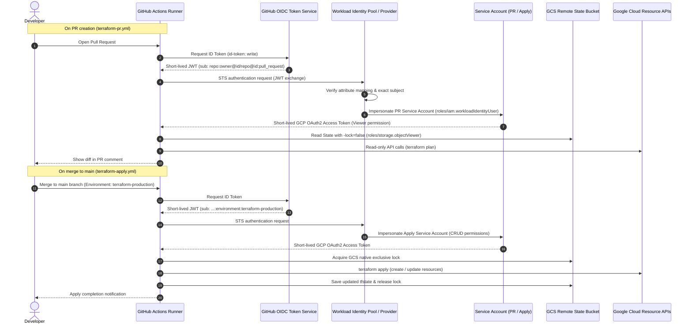

[English](07-cicd-oidc-remote-state.en.md) | [日本語](07-cicd-oidc-remote-state.md)

> This is an English translation added on 2026-10-14. It preserves the dates, data and caveats of the source record (Japanese original). No new experiment was run.

# CI/CD, Workload Identity Federation, and Remote State

## Authentication Design and CI/CD Flow



- The Issuer is only `https://token.actions.githubusercontent.com`
- The Provider condition fixes `repository_owner` and `repository`
- The PR subject is the exact format `repo:<OWNER>@<OWNER_ID>/<REPOSITORY>@<REPOSITORY_ID>:pull_request`
- The Apply subject is the exact format `repo:<OWNER>@<OWNER_ID>/<REPOSITORY>@<REPOSITORY_ID>:environment:terraform-production`
- A fork PR can have the same base repository subject, so the Workflow also requires `head.repo.full_name == github.repository`
- No Service Account Key, Client Secret, or long-lived Credential is created
- The PR SA has a read-only custom role and State Object Viewer
- The Apply SA has a CRUD custom role for the Resource families managed by root, and State Object Admin

## Remote State

- Dedicated GCS Bucket
- Uniform Bucket-Level Access
- Public Access Prevention `enforced`
- Object Versioning
- Google-managed server-side encryption
- prefix: `terraform/root`
- State locking native to the Terraform GCS Backend
- Only the PR plan uses `-lock=false`, and it is not granted State write permission

During migration, the Local State is saved to an ignored directory, and `terraform init -migrate-state` is run after the SHA-256 of the source and the backup match. The State resource count, lineage, serial, and plan results before and after migration are checked without exposing secret values.

## Migration Results

- Copied the Local State to the ignored directory and confirmed that the SHA-256 of the source and the backup matched
- Migrated to the `terraform/root` prefix with `terraform init -migrate-state -force-copy`
- Confirmed the State object on GCS, matching lineage, and 17 resources in the State
- The State serial increased by 1 with the migration, but there was no diff on existing Resources
- A plan with normal locking enabled succeeded, and it was confirmed that no orphaned lock remained afterward
- The root plan after migration was No changes

## GitHub Settings

Repository / Environment Secrets:

- `GCP_PROJECT_ID`
- `GCP_WIF_PROVIDER`
- `GCP_PR_SERVICE_ACCOUNT`
- `GCP_APPLY_SERVICE_ACCOUNT`
- `GCP_TF_STATE_BUCKET`

Repository Variable:

- `GCP_ENVIRONMENT_ACTIVE`

`terraform-production` is restricted to main. After cleanup, keep `GCP_ENVIRONMENT_ACTIVE=false`, and do not start cloud jobs until bootstrap and State are restored.

## PR OIDC Subject Verification

During the first Remote State connection, `iam.serviceAccounts.getAccessToken` was denied when obtaining the Service Account access token. Checking only `sub` and `aud` in a temporary step that does not output the JWT body showed that `aud` matched the WIF Provider, while `sub` contained the stable numeric IDs of the GitHub owner/repository.

The Terraform PR subject was changed to the following anonymized format.

```text
repo:<OWNER>@<OWNER_ID>/<REPOSITORY>@<REPOSITORY_ID>:pull_request
```

- Keep the exact subject, and do not relax it to a wildcard or `principalSet`
- Do not change the Provider's repository name/owner condition, audience, or Apply subject
- Do not add permissions other than `roles/iam.workloadIdentityUser`
- The IAM member uses `create_before_destroy`, deleting the old binding after the new binding is created
- The plan after the bootstrap apply was No changes
- With the PR Workflow after the fix, confirmed WIF authentication, GCS backend initialization, and root plan No changes
- The temporary debug step for checking claims was removed after authentication succeeded

## Apply Environment OIDC Subject Verification

With `terraform-production` still restricted to main, only the JWT's `sub` and `aud` were checked in a temporary job with normal apply disabled. The token body, header, signature, other claims, and Credentials were not output.

The actual `sub` was in the following anonymized format.

```text
repo:<OWNER>@<OWNER_ID>/<REPOSITORY>@<REPOSITORY_ID>:environment:terraform-production
```

Only the Terraform Apply subject was changed to this exact format. The PR subject, attribute condition, audience, and Service Account permissions were not changed, and no wildcard or `principalSet` was used. The IAM member used `create_before_destroy`, deleting the old binding after the new binding was created.

- bootstrap apply: only the Apply binding, `1 added / 0 changed / 1 destroyed`
- plan after bootstrap apply: No changes
- root plan: No changes
- Temporary claim debug job: deleted
- Normal apply job: re-enabled
- GitHub Actions: WIF authentication, GCS backend initialization, saved plan, and apply succeeded
- CI plan: No changes
- CI apply: `0 added / 0 changed / 0 destroyed`
- locking: plan/apply completed through the GCS backend's native locking path without using `-lock=false`

## Cleanup

1. Confirm the State list and No changes plan for root/bootstrap
2. Save the GCS root State and the bootstrap State to `.state-backups/`, and confirm SHA-256
3. Confirm that root's 25 destroys are delete-only, then apply
4. Confirm root State 0 and workload/Monitoring at 0 active
5. Confirm that bootstrap's 13 destroys are delete-only, then apply
6. Confirm via the API that State Bucket, WIF, Service Account, custom role, and IAM binding are at 0 active

After the State Bucket is deleted, the root backend can no longer be connected to, so the final confirmation of root State 0 was done first. Project deletion and bulk deletion of existing resources were not performed.

To prevent accidental re-creation after cleanup, the workflow's existing condition `vars.GCP_ENVIRONMENT_ACTIVE == 'true'` is used. The candidates for later deletion on the GitHub side, now unnecessary, are listed below. The values were not deleted this time.

After cleanup, the Repository Variable was changed to `false`. In the PR workflow, static checks succeeded and the cloud plan job was Skipped before OIDC authentication and GCS initialization. After merge, the entire job of the main Apply workflow was also Skipped, confirming that it does not proceed to connect to the deleted WIF/GCS or to a re-creation plan.

- Repository / Environment Secrets: `GCP_PROJECT_ID`, `GCP_WIF_PROVIDER`, `GCP_PR_SERVICE_ACCOUNT`, `GCP_APPLY_SERVICE_ACCOUNT`, `GCP_TF_STATE_BUCKET`
- Repository Variable: `GCP_ENVIRONMENT_ACTIVE`
- Environment: `terraform-production`

When rebuilding, apply bootstrap first, update the GitHub settings to the new real values, and then set the enable flag to `true`.
