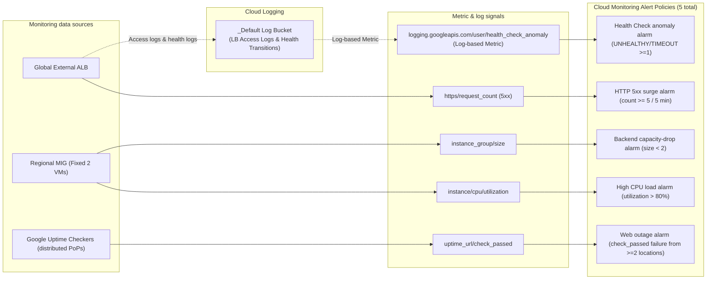
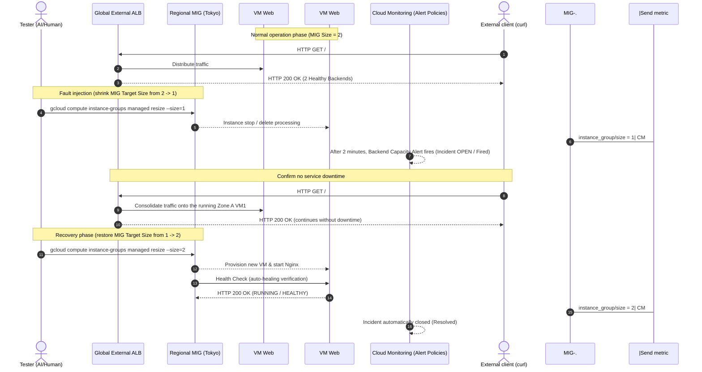

[English](08-monitoring.en.md) | [日本語](08-monitoring.md)

> This is an English translation added on 2026-10-14. It preserves the dates, data and caveats of the source record (Japanese original). No new experiment was run.

# Monitoring

## Design

Use only native metrics, external monitoring, and Health Check state-transition logs. Ops Agent, Log Analytics, BigQuery export, a dedicated Log bucket, and Dashboards are not added.

| Requirement | Data source | Alert condition |
|---|---|---|
| Web outage | Uptime Check `check_passed` | Failures from 2 or more locations continuing for 2 minutes |
| Backend / VM capacity anomaly | `compute.googleapis.com/instance_group/size` | Regional MIG below 2 instances continuing for 2 minutes |
| Health Check anomaly | Health Check state-transition log-based metric | 1 or more `UNHEALTHY` or `TIMEOUT` continuing for 1 minute |
| High CPU load | `compute.googleapis.com/instance/cpu/utilization` | 5-minute average above 80% continuing for 5 minutes |
| HTTP 5xx increase | `loadbalancing.googleapis.com/https/request_count` | 5 or more in 5 minutes |

The Uptime Check verifies a 2xx response and a page identification string over HTTP 80. By combining the MIG and Health Check, VM stops, self-healing, and Backend anomalies can be tracked without fixing individual VM IDs.

Because the validation requirements did not specify a notification destination, no Notification Channel is created. Alert Policies and Incidents can be viewed in Cloud Monitoring. For production adoption, add an organization-managed notification destination.

## Logs

The existing Terraform had already enabled the following, so Monitoring did not change any existing resources.

- Global External Application Load Balancer access log: sample rate 100%
- Load Balancer Health Check: Backend state-transition log
- Storage destination: the project's standard Cloud Logging `_Default` bucket
- Retention period: standard 30 days

The Health Check log is generated only on state transitions and is not necessarily generated when an endpoint is removed. For this reason, the Backend capacity alert is used alongside it.

## Cost

- Uptime Check: expected to stay within the free allotment of 1 million executions per month
- Google Cloud standard metrics: non-billable metrics are used
- Logging: only Health Check state transitions and low-traffic LB access logs, so a small ingestion volume is expected
- Alerting: according to official pricing, billing is scheduled to start no earlier than 2027-09-01. Limited to 5 metric references
- Long-term retention, Log export, Ops Agent, and Synthetic Monitor were not adopted

For a short validation, the incremental monitoring cost is expected to be practically small, but the actual amount depends on traffic volume and Billing conditions.

## Differences from AWS / Azure

- Compared with CloudWatch Alarm in the AWS edition, GCP combines Uptime Check, managed-service metrics, and Logging metrics.
- Compared with the Application Gateway metric alert in the Azure edition, for the GCP Health Check the state-transition log is central to investigation.
- Because the Regional MIG automatically repairs VMs, monitoring uses MIG size and the instance-name prefix rather than fixed VM IDs.
- GCP external monitoring can aggregate results from Google's distributed checkers, so it is not limited to monitoring from inside a single Region.

## Terraform Pre-checks

- `terraform fmt -check`: succeeded
- `terraform validate`: succeeded
- root plan: 7 create, 0 change, 0 destroy
- Update or replacement of existing Web, Network, Identity, and State resources: none

## Initial Apply and Fixes

The initial main apply stopped at 2 resources due to Monitoring API condition constraints, after creating 5 of 7. Because it was not an IAM shortage, no permissions were added.

- Fixed the duration of the condition using `evaluation_missing_data` from 0 seconds to 60 seconds
- Fixed the unsupported `COMPARISON_GE` to the equivalent `COMPARISON_GT` with threshold 4
- Performed State refresh after the partial apply
- Corrected plan: 2 create for the Alert Policies not yet created, 0 change, 0 destroy

On the re-apply, the HTTP 5xx Alert was created, but the Monitoring resource type of the Health Check log-based metric did not match. Because Cloud Logging's `gce_instance_group` is mapped to `global` in Monitoring, only the Alert filter was corrected to `global`. The filter of the Logging metric itself remains limited to the target MIG.

On the third main apply, the Health Check Alert that had not been created was added. The final results are as follows.

- GitHub Actions: GCS backend initialization, WIF authentication, and saved plan apply succeeded
- Final apply: 1 added, 0 changed, 0 destroyed
- Monitoring configuration: 1 Uptime Check, 5 Alert Policies, 1 log-based metric
- Final root plan: No changes
- Changes to IAM / WIF / existing Web resources: none

## Failure Test

The Regional MIG's target size was temporarily shrunk from 2 instances to 1, causing a capacity drop without changing the existing Terraform definition.

| Check item | Result |
|---|---|
| Backend state | Dropped from 2 to 1, and the remaining Backend was Healthy |
| HTTP | Continued to return 200 during the test |
| Monitoring metric | `instance_group/size` changed from 2 to 1 |
| Alert | `backend capacity below target` was Open (Fired) |
| Recovery | Restored the target size to 2; the 2 instances were both RUNNING / HEALTHY, MIG Stable |
| Resolved | After the size returned to 2, the Incident was Closed |
| Terraform consistency | The plan after recovery was No changes |

There were delays of several minutes between the scale-down and Monitoring collection / Incident evaluation. During recovery, the new VM was temporarily in Health Check `TIMEOUT`, but it transitioned to Healthy after autohealing/verification, and no service outage occurred. The Fired state of the Health Check Alert itself was not confirmed in this short test.

## Work Classification

- Human: approved the Monitoring implementation and the execution of the safe failure test
- AI: design, Terraform implementation, plan safety checks, PR creation and merge, apply log diagnosis, API constraint fixes, fault injection and recovery, and Fired/Resolved confirmation
- Permissions: no IAM added for the Monitoring work

## Cleanup

- Before cleanup: confirmed 1 Uptime Check, 5 Alert Policies, and 1 log-based metric via State/API
- root destroy plan: all 25, including Monitoring, were delete-only
- After destroy: Alert Policies, Uptime Check, and the target log-based metric are at 0 active
- The project's default bucket of standard Cloud Logging is itself an existing managed service and is out of scope for deletion
- No IAM permissions were added for Monitoring, so no separate IAM cleanup is needed
