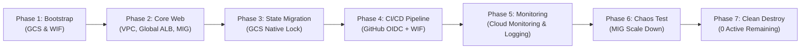
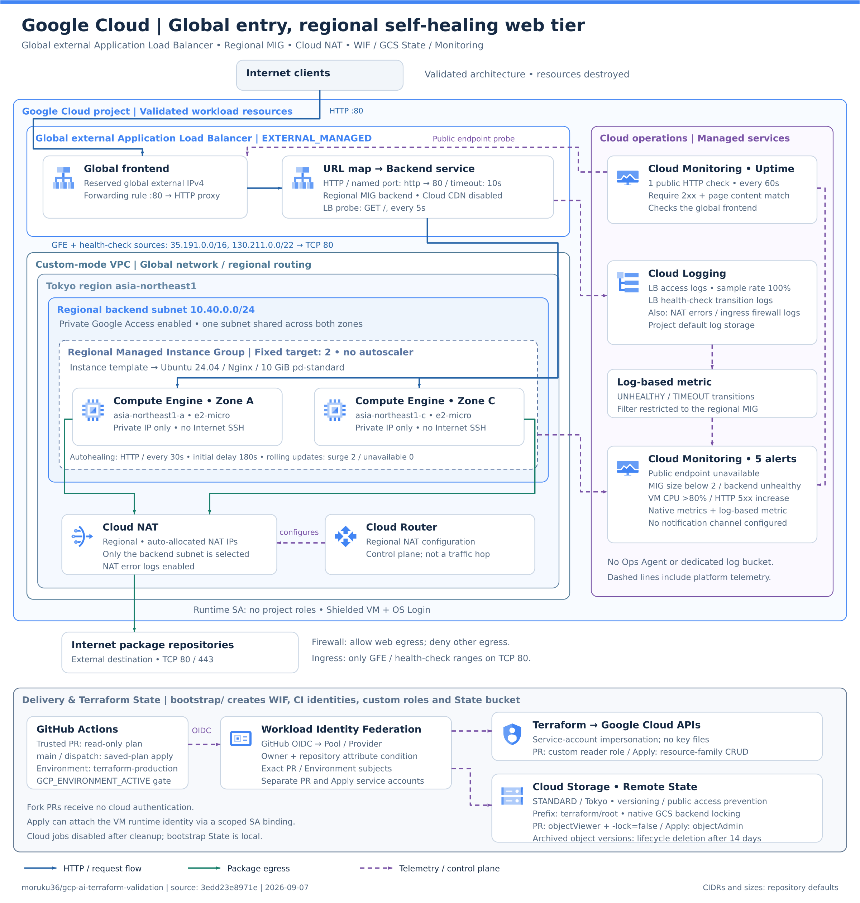
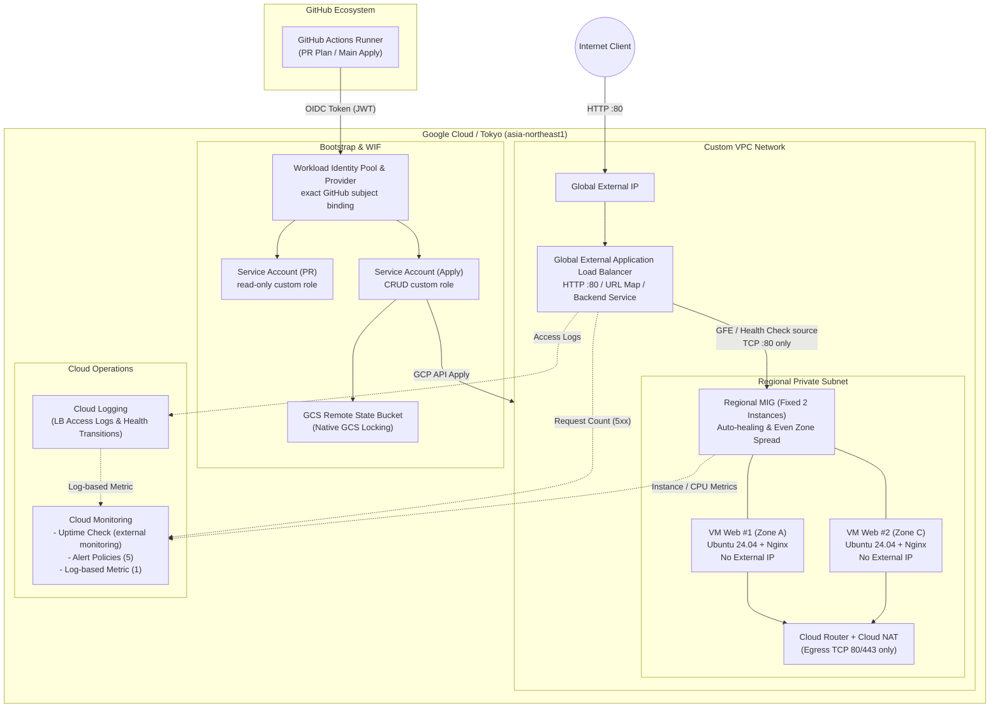

[English](README.en.md) | [日本語](README.md)

> This is an English translation added on 2026-10-14. It preserves the dates, data and caveats of the source record (Japanese original). No new experiment was run, and the original experiment date (2026-09-07) is unchanged.

# GCP AI Terraform Validation

**[AWS / Azure / GCP Cross-Cloud Final Comparison Report](../docs/final-report.en.md)** — execution results, AI failures and recovery, human responsibilities, and reproducibility review.

The historical records below retain their original scope and status. For the updated explanation of the certification-inspired Level 1–3 categories and the human/Codex division of responsibility, see the [consolidated project overview](../README.md). The historical "Level 2-equivalent" wording refers to this project's validation category and does not establish certification equivalence.

## Validation Purpose

Starting from common requirements written in natural language, this validation checks whether AI/Codex can design a Google Cloud-native configuration and safely implement it through Terraform, GitHub Actions, Workload Identity Federation, GCS Remote State, Monitoring, failure testing, and cleanup.

This is not a simple service-name substitution of the AWS and Azure editions. It records the differences in Regional Managed Instance Group, Global External Application Load Balancer, GCP IAM, GCS Backend locking, and so on.

## Validation Lifecycle Flow



## Architecture





The Internet-facing entry point is consolidated into a Global External Application Load Balancer, which forwards HTTP to two private VMs in a Regional MIG in the Tokyo region. Package retrieval by the VMs is limited to Cloud NAT, and Cloud Monitoring / Logging monitor availability, Backend, CPU, and HTTP 5xx. GitHub Actions authenticates with short-lived credentials through Workload Identity Federation, and Terraform State is shared in GCS with versioning and locking enabled.

- Region: Tokyo (`asia-northeast1`)
- Compute: Regional Managed Instance Group spread evenly across 2 Zones, fixed at 2 instances
- Frontend: Global External Application Load Balancer, HTTP 80 only
- Backend: Ubuntu 24.04, Nginx, no External IP, no Internet SSH
- Egress: only TCP 80/443 allowed, via Cloud NAT
- State: migrated to a dedicated GCS Bucket (Versioning / Public Access Prevention / native locking)
- CI/CD: GitHub OIDC + Workload Identity Federation, with separate PR / Apply Identities
- Monitoring: Cloud Monitoring, Cloud Logging, and Uptime Check implemented and verified at the necessary minimum

See [Architecture](../docs/gcp/02-architecture.en.md) for details.

## Current Progress

- [x] Checked, with anonymization, the local environment, authentication state, selected Project, Region/Zone, and existing resource boundaries
- [x] Initial implementation of root / bootstrap Terraform
- [x] `terraform fmt`, `terraform init -backend=false`, `terraform validate`
- [x] Read-only plan using a short-lived token from the existing gcloud login (root 17 create, bootstrap 13 create, no destroy / replace)
- [x] Web infrastructure apply (17 added / 0 changed / 0 destroyed) and HTTP 200
- [x] GCS Remote State migration, lineage and 17-resource match, locking enabled, No changes after migration
- [x] GitHub Actions / WIF working in practice
- [x] Monitoring and failure testing
- [x] root / bootstrap cleanup and confirmation of 0 remaining managed resources

> On 2026-09-07, the work was completed from build through failure testing and cleanup. The configuration remains as reproducible Terraform; the real Project ID, Project Number, Service Account email, credentials, Public IP, and actual State Bucket name are not stored in Git.

## Final Result Summary

### Quantitative Metrics

| Metric | Result / Status | Visual indicator |
|---|---|---|
| **Overall evaluation** | **Success (Level 2 achieved autonomously)** | `██████████ 100%` |
| **HTTP 200 availability** | No downtime even during failure testing | `██████████ 100%` |
| **Root resources fully deleted** | 25 / 25 deleted | `██████████ 100%` |
| **Bootstrap fully deleted** | 13 / 13 deleted | `██████████ 100%` |
| **Remaining managed resources** | 0 active | `░░░░░░░░░░ 0` |

### Status by Validation Item

- Terraform: manages 17 Web infrastructure resources, 7 Monitoring resources, and 13 bootstrap resources, with no unintended replace
- GitHub Actions: ran PR plan and main saved-plan apply. Cloud authentication is not passed to fork PRs
- Identity: no Service Account Key created; authenticated with GitHub OIDC + WIF using exact subjects for PR / Apply
- Remote State: verified GCS with versioning / Public Access Prevention and the backend's native locking
- Monitoring: 1 Uptime Check, 5 Alert Policies, 1 log-based metric
- Failure testing: shrinking the MIG from 2 instances to 1 kept HTTP 200, and Alert Fired / Resolved were confirmed
- Cleanup: root 25 and bootstrap 13 resources deleted with delete-only plans. Managed resources are at 0 active; the existing default network and existing Service Accounts were protected. GitHub cloud jobs were also disabled

## Key Points versus AWS / Azure

GCP adopted Zone distribution and self-healing through a Regional MIG, a Global External Application Load Balancer, and Service Account impersonation. Compared with AWS's per-AZ Subnet/EC2 and Azure's Zone-pinned VMs/Application Gateway, GCP makes it easier to consolidate Backend lifecycle into the MIG, but the WIF Pool, Provider, attribute mapping, and exact principal strings made it the configuration with the most items to isolate.

## Final Evaluation

Design, Terraform implementation, CI/CD, Monitoring, failure isolation, and delete-only cleanup at the project's Cloud Engineer Level 2-equivalent validation scope were completed primarily by AI. What humans needed to provide were approval boundaries such as the first cloud change, replacing exact IAM bindings, and account identity verification.

## Reproduction Steps (Common 5 Steps)

Prerequisites: Terraform `>= 1.10.0, < 2.0.0`, Google Cloud CLI already logged in, and sufficient permissions on the target project. Because the resources have now been deleted, apply them with the following steps when re-validating.

```powershell
# 1. Authentication and project setup
gcloud auth application-default login
$env:TF_VAR_project_id = gcloud config get-value project

# 2. Build Bootstrap (GCS State Bucket & WIF)
Copy-Item bootstrap/terraform.tfvars.example bootstrap/terraform.tfvars
# Set the identifiers in bootstrap/terraform.tfvars
terraform -chdir=bootstrap init
terraform -chdir=bootstrap plan -out=tfplan
terraform -chdir=bootstrap apply tfplan

# 3. Backend configuration (enable Remote State)
Copy-Item backend.tf.example backend.tf
terraform init -backend-config="bucket=<YOUR_GCS_STATE_BUCKET>" -backend-config="prefix=terraform/root"

# 4. Apply Root (VPC, GCLB, MIG, Monitoring)
terraform fmt -check -recursive
terraform validate
terraform plan -out=tfplan
terraform apply tfplan
terraform output -raw load_balancer_ip

# 5. Clean Destroy (when validation ends)
terraform destroy
terraform -chdir=bootstrap destroy
```

## Documentation

- [Validation Scenario](../docs/gcp/01-scenario.en.md)
- [GCP Architecture](../docs/gcp/02-architecture.en.md)
- [Terraform Implementation](../docs/gcp/03-implementation.en.md)
- [Troubleshooting](../docs/gcp/04-troubleshooting.en.md)
- [Execution Results and Aggregation](../docs/gcp/05-results.en.md)
- [Lessons Learned and AWS/Azure Comparison](../docs/gcp/06-lessons-learned.en.md)
- [CI/CD, WIF, and Remote State](../docs/gcp/07-cicd-oidc-remote-state.en.md)
- [Monitoring](../docs/gcp/08-monitoring.en.md)

## Notes for Re-running and Known Caveats (Gotchas)

> [!WARNING]
> **1. Pre-binding WIF (Workload Identity Federation)**:
> Before connecting from GitHub Actions, the `roles/iam.workloadIdentityUser` role must be correctly bound on the GCP-side Workload Identity Pool and Service Account for the repository (`repo:moruku36/cloud-validation-level2-multicloud:*`).
>
> **2. Load balancer health check propagation time**:
> Right after deployment, the External ALB and MIG take several minutes for health checks from the proxy subnet to become `HEALTHY`. Run the HTTP 200 test after the health checks have stabilized.
